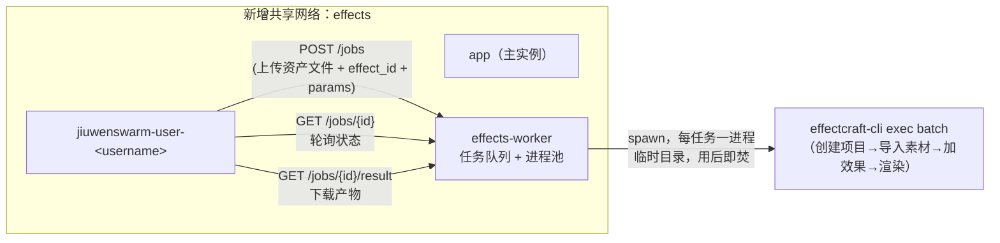

# 剪辑特效接入 EffectCraft 设计方案

## 1. 设计定位与阅读说明

本文是开发前方案，回答"剪辑（Director 编辑模式）如何获得特效处理能力，且该能力交给哪个外部工具、通过什么边界接入"。建议按顺序阅读：先读 §2 了解现状与目标场景，再读 §4 了解总体方案与关键取舍，§5-6 是落地到模块/接口/实施项的细节，§8-9 是验证与风险。实际实施、偏差与验证结果不在本文维护，归档在 features（见 §11）。

## 2. 背景、目标与范围

### 2.1 背景与问题

Director 的"剪辑"（Edit 模式，前端 `EditTabShell.tsx`）目前只支持时间线编排：拖入图片/视频/音频片段、裁剪（仅图片）、拆分、移动、多轨叠放，再通过"保存到项目"调用 `director.clip.compose`（`jiuwenswarm/server/runtime/director/director_clip_compose.py`，纯本地 ffmpeg：裁剪/缩放补边/拼接/混音）生成一个新的合成视频资产。整条链路里没有任何"特效"概念——不能调色、不能加转场/发光/模糊，也不能对音频做均衡/混响处理。用户若想要这些效果，只能导出后用外部工具处理，再重新上传，无法在产品内完成。

同一台主机上另有一个独立仓库 `effectcraft`（本次调研确认：纯 Rust 实现的专业级动态图形/视效合成器，功能对标 After Effects，自带 CLI 与 MCP stdio 服务，308 个内置效果），用户希望把它接入剪辑，让资产"可以被进一步修改"。

### 2.2 目标与关键场景

| 场景 / 触发条件 | 当前行为 | 目标行为 / 可观察变化 |
| --- | --- | --- |
| 用户在资产库或时间线上选中一个图片/视频/音频资产，点击新增的"特效"入口 | 不支持；只能裁剪/拆分/排列/合成 | 弹出特效面板，从精选目录选择效果、设置参数，点击"应用"后生成一个新的派生资产；原资产不变 |
| 特效渲染需要数秒到数分钟 | 不适用（无此能力） | UI 进入处理中状态（复用生成资产时已有的 pending/spinner 视觉），用户可继续其他操作，不被阻塞 |
| 特效渲染失败（参数不支持、输入格式不兼容、工作进程异常） | 不适用 | 对应资产标记为失败并显示错误，原资产不受影响，可重试 |
| 用户对一个"特效"产出的派生资产再应用另一个特效 | 不适用 | 允许链式应用，每次都产生新的派生资产，保留"由谁、经过什么效果"生成的溯源信息 |

### 2.3 本次范围与非目标

- 本次包含：新增共享 `effects-worker` 服务及其内部任务队列；`director.clip.effects.list` / `director.clip.effect.apply` / `director.clip.effect.check_status` 三个 RPC；`DirectorAsset` 数据模型的 effect 相关字段扩展；剪辑前端资产库/时间线的"特效"入口与特效面板组件；部署拓扑变更（新增共享 Docker 网络，`deploy/provision_user.sh`/`deploy/reconnect_user_networks.sh` 同步更新）；v1 精选效果目录（色彩校正、模糊/发光、速度/转场、基础抠像、音频 EQ/混响/归一化等约 10-15 个效果）的能力与参数设计。
- 本次不包含：对 effectcraft 自身代码的任何修改（v1 只做外部调用方）；effectcraft 完整的图层/关键帧/3D/表达式合成能力接入；实时预览（随参数调整即时重渲染）；GPU 相关或依赖额外模型下载的效果（Roto Brush、Face Tracking）；`effects-worker` 的多副本/弹性扩容部署设计。

依赖、关键假设和待确认事项集中在 §3，不在此重复登记。

### 2.4 术语与上下文

- **剪辑**：Director 编辑模式，前端代码位于 `jiuwenswarm/channels/web/frontend/src/features/director/`，架构权威文档为该目录下的 `ARCHITECTURE.md`。
- **effectcraft**：独立仓库 `/Users/yeoboonhong/Documents/GitHub/effectcraft`，"ArtCraft" 系列中的动态图形/视效合成器，纯 Rust，自带 `effectcraft-cli`（一次性命令执行 + MCP stdio 服务两种模式）。本设计只把它当作外部二进制依赖调用，不改动其源码。
- **DirectorAsset**：Director 项目内的资产记录（`jiuwenswarm/server/runtime/director/director_store.py:39-79`），字段含 `asset_id`/`type`/`status`/`file_path`/`cloud_url`/`params` 等，是本设计扩展的现有数据结构。

## 3. 设计约束、假设与待决问题

- 已确认约束与依赖：
  - 每用户独立容器 + 独立 Docker 网络的隔离模型（见 `deploy/architecture.md` §2）必须保持——新增服务不能破坏"一个用户网络恰好两个成员（`app` + 该用户）"的既有不变量，必须通过新增共享网络接入，而不是加入某个用户的专属网络。
  - `DirectorAsset` 的 `pending`/`ready`/`failed` 生命周期、`file_path` 本地权威来源规则、以及 `_schedule_cloud_mirror` 云镜像管道必须被复用，不新建一套平行的资产/生命周期机制。
  - effectcraft 本身无认证、无多租户概念（一个进程持有一个会话），这是调研已核实的事实，不是假设。
- 关键假设（尚待核实）：
  - effectcraft-cli 的 `exec`/`batch` 命令集与子任务调研中列出的工具名（`execute_command`/`get_project`/`get_comp`/`get_layer`/`set_property`/`add_effect`/`add_keyframe`/`render_frame`/`list_effects`/`run_script`/`batch`）行为与 `docs/agents.md` 描述一致、且可被"创建项目 → 导入素材 → 加特效 → 渲染"这样的无状态单次调用脚本化。若 `batch` 不支持跨这些步骤的原子组合，§4.2 D-02 的"每任务一次 CLI 调用"假设需要改为"每任务多次顺序调用"，不影响整体架构，但会增加 `effects-worker` 内部的实现复杂度。
  - v1 精选效果目录中的效果均可在无 GPU、无额外模型下载的前提下完成渲染。若个别效果实际依赖模型下载，需要从 v1 目录中移除或改为预下载打包进 `effects-worker` 镜像。
  - effectcraft 渲染耗时量级与现有生成式任务（`VIDEO_GEN_*`，观察到约 2-3 分钟量级）相近，用于确定 `effects-worker` 的超时与并发默认值；若实际耗时差异很大，需要重新评估默认超时。
- 待决问题：
  - v1 精选效果目录的最终清单（哪 10-15 个效果、各自暴露哪些参数）尚未与用户/产品侧确认，影响 §4.2 D-05 的落地范围。
  - `effects-worker` 的并发 worker 数量、单任务超时时间尚未压测，需要原型验证后定稿（见 §9.1 风险）。
  - 是否锁定 effectcraft 的某个 commit/tag 构建 `effects-worker` 镜像，还是跟随其 main 分支——鉴于该项目上线仅一个月且提交频繁，建议锁定，但最终策略待确认。

## 4. 总体方案与设计取舍

### 4.1 方案概览

新增一个与 `postgres`/`nginx` 同级的共享 Docker 服务 `effects-worker`，内部维护一个小型任务队列和进程池；每个"特效"任务都用一次性的 `effectcraft-cli` 子进程处理（独立临时目录，用后即焚），通过 HTTP 提交任务、轮询状态、下载结果。`director_manager.py` 新增三个 RPC，复用现有"生成式资产"的 `pending → ready/failed` 生命周期和云镜像管道；前端复用现有 `pendingGeneration`/`pollTimer` 轮询机制，只新增"特效"入口与特效面板 UI。`effects-worker` 不做身份校验，信任边界完全在网络拓扑层——只有 `app` 与各用户容器能连接到它，这与现有 Postgres/Tencent COS 共享凭证的信任模型一致。

### 4.2 关键决策

#### D-01 效果处理能力通过新增共享服务接入，而非既有 MCP 连接器或生成式 Provider 配置位

- 选择与依据：调研确认 effectcraft 自带 MCP stdio 服务和 CLI，但没有网络 API、没有凭证/多租户概念——这与"用户自装、带凭证"的 MCP 连接器模式（如 `tencent-cos`）语义不符；也与"HTTP 端点 + API Key"的生成式 Provider 模式（`VIDEO_GEN_*`/`VISUAL_GEN_*`）不符，因为 effectcraft 根本没有网络端点。新增一个专用的共享服务，职责单一（接任务、跑 effectcraft、收产物），是唯一不需要往 effectcraft 身上"发明"一个它本来没有的契约的方案。
- 代价与成立条件：多一个需要独立构建、部署、运维的服务；需要新增共享网络并同步 `deploy/provision_user.sh`/`deploy/reconnect_user_networks.sh`。只要 effectcraft 保持"本地进程、无网络 API"的现状，这个代价是必须付出的。
- 实现体现：§5.1-5.3（服务职责、RPC 契约）、§6.1 实施项 I-01~I-03。
- 相关候选：R-01、R-02、R-03（见 §4.3）。
- 确认依据：尚未经过真实评审，待 §10 补充。

#### D-02 effects-worker 内部"每任务一进程"调用 effectcraft-cli，不维持常驻 MCP 会话

- 选择与依据：effectcraft 官方定位是"一个进程持有一个会话"，没有多租户隔离；每任务一个全新进程、全新临时目录，天然做到"一进程=一任务=一租户"，隔离边界靠进程生命周期而不是靠应用层过滤逻辑——这与 Tencent COS 连接器"把隔离做进共享工具的调用边界里，而不是信任共享工具自己分租户"的既有安全设计哲学一致。
- 代价与成立条件：每任务都有进程启动开销（无法像常驻会话一样复用已加载的项目状态）；若后续发现这个开销是性能瓶颈，需要重新评估。
- 实现体现：§5.6 状态机、§5.11 资源与文件布局。
- 相关候选：R-04。

#### D-03 资产通过 HTTP 请求体传输，不在容器间共享 volume

- 选择与依据：每用户容器各自拥有独立的 `/home/app/.jiuwenswarm` volume，是现有隔离设计的核心保证；给 `effects-worker` 挂载任何用户的 volume 都会打破这个保证。改为"任务提交时上传文件、任务完成后下载产物"的 HTTP 传输，不需要任何共享挂载。
- 代价与成立条件：大文件（长视频）传输有网络开销；在内部 Docker 网络内，这个开销可接受。
- 实现体现：§5.3 接口定义。

#### D-04 派生资产非破坏式写入，复用现有 DirectorAsset 生命周期与云镜像管道

- 选择与依据：`clip.compose`、生成式资产都遵循"产出永远是新资产，原资产不动"的既有约定；特效处理延续同一约定，任务完成后在现有 `DirectorStore` 上追加一条新的 `DirectorAsset`（标 `ready`，`params` 记录 `source_asset_id`/`effect_id`/`effect_params` 溯源），并原样触发 `_schedule_cloud_mirror`，不需要对云镜像管道做任何改动。
- 代价与成立条件：无额外代价；这是对现有模式的直接复用。
- 实现体现：§5.5 数据模型、§5.7 正常执行流程。

#### D-05 v1 只暴露精选效果目录，不暴露 effectcraft 完整合成能力

- 选择与依据：effectcraft 有 308 个效果、完整的图层/关键帧/3D/表达式系统，直接暴露会让前端特效面板和参数设计复杂到不可控；v1 按"调色/模糊发光/速度转场/基础抠像/音频处理"分组，挑选约 10-15 个高频效果，每个效果只暴露少量数值参数。
- 代价与成立条件：牺牲了 effectcraft 的大部分能力；若后续需要更丰富的合成能力，可以考虑引入 effectcraft 的 WASM 构建（`apps/effectcraft-web`）做真正的浏览器内编辑器，但那是完全不同量级的项目，不在本设计范围内。
- 实现体现：§2.3 非目标、§6.1 实施项 I-07/I-08。

### 4.3 替代方案与排除理由

| 候选 / 关联决策 | 候选目的与关键差异 | 拒绝或暂缓原因 | 重新评估条件 |
| --- | --- | --- | --- |
| R-01 / D-01 把 effectcraft 包装成一个新的 MCP 内置连接器（仿 `tencent-cos`） | 复用"我的扩展"连接器市场 UI 与 `call_mcp_tool` 调用路径 | MCP 连接器模式假设的是"用户自装、带凭证、可选连接/未连接"的第三方工具，effectcraft 没有凭证、不是用户按需安装的能力，语义不匹配；且 MCP 连接器是每工作区装一份，等于把重量级引擎复制 N 份进每个用户容器 | 若未来希望把特效能力做成"用户可选装的扩展"而非内建能力，可重新评估 |
| R-02 / D-01 套用 `VIDEO_GEN_*`/`VISUAL_GEN_*` 生成式 Provider 配置位 | 复用 `get_default_models()`/`*_gen_tools.py` 的 HTTP Provider 调用模式 | 该模式假设外部是一个 HTTP 端点（API Key + Base URL），而 effectcraft 完全没有网络 API，只有本地 stdio/CLI；套用会需要先凭空发明一层不存在的 HTTP 契约，复杂度高于直接新建一个专用服务 | 若未来 effectcraft 自身新增官方 HTTP 服务模式，可重新评估改用此模式 |
| R-03 / D-01 把 effectcraft 引擎直接内嵌进每个用户容器 | 不需要新增共享服务和网络拓扑 | effectcraft 引擎体量大（约 470k 行 Rust），在已经资源受限的每用户容器（单个约 1-1.5GB 内存，主机当前仅约 5GB 余量）中重复部署，会迅速耗尽主机内存预算，且与"用户容器尽量轻量"的既有设计方向相反 | 若未来主机资源大幅扩容，或用户规模始终很小（1-2 个用户），可重新评估 |
| R-04 / D-02 `effects-worker` 内维持常驻 MCP stdio 会话以复用进程、减少启动开销 | 避免每任务都重新启动 effectcraft-cli 进程的开销 | effectcraft 官方模型是"一进程一会话"，常驻会话意味着多个任务共享同一进程内存状态，一旦出现状态未清理干净的缺陷就是跨任务（可能跨用户）的数据泄漏，与既有"隔离边界必须结构性成立，不依赖工具自己做干净"的安全哲学冲突 | 若压测证明进程启动开销是实际性能瓶颈，且能设计出可靠的会话内状态隔离/清理机制，可重新评估 |

## 5. 详细设计

### 5.1 模块责任与关键不变量

- `effects-worker`（新增服务）：接收任务提交、维护任务队列与进程池、驱动一次性 `effectcraft-cli` 子进程、持有任务结果直到被下载或过期清理。不持有任何用户身份信息，不做认证——信任边界完全在网络拓扑层（见 §5.11）。
- `director_manager.py`（现有模块，新增 RPC handler）：解析剪辑端请求、把资产的本地 `file_path` 转交给 `effects-worker`、维护 `DirectorAsset` 的 `pending`/`ready`/`failed` 转换、复用 `_schedule_cloud_mirror` 完成云镜像。不直接调用 effectcraft，不关心 `effects-worker` 内部如何实现。
- `directorStore.ts`（现有模块，复用并扩展）：发起特效任务、复用既有 `pollTimer`/`pendingGeneration` 轮询机制，不新增第二套轮询实现。
- 关键不变量：
  - 一个用户的特效任务，其输入文件、临时产物、任务记录，任何其他用户都不可见、不可枚举（见 §5.11）。
  - 原始资产的 `file_path` 在特效处理前后不变；特效处理永远产出新的 `DirectorAsset`。
  - `effects-worker` 不可达时，剪辑现有功能（裁剪/拆分/合成）不受影响——特效是增量能力，不是现有链路的前置依赖。

### 5.3 接口定义与消息契约

#### Director RPC（`director_manager.py` 新增）

| 入口 / 消息 | 调用方 / 消费者 | 输入与成功结果 | 失败语义 |
| --- | --- | --- | --- |
| `director.clip.effects.list` | 剪辑前端特效面板，打开面板时调用 | 输入：`{}`；成功：精选效果目录（分组、效果 id、名称、参数定义） | 无特殊失败语义，静态数据 |
| `director.clip.effect.apply` | 特效面板"应用"按钮 | 输入：`{project_id, asset_id, effect_id, params}`；成功：`{project, asset_id: <新派生资产 id>}`，新资产初始状态为 `pending`、带 `job_id` | `asset_id` 不存在、`effect_id` 不在目录中、参数校验失败：同步报错，不创建资产；`effects-worker` 不可达：同步报错，不创建资产 |
| `director.clip.effect.check_status` | 前端 `pollTimer`，与现有 `director.generate.check_status` 轮询模式一致 | 输入：`{project_id, asset_id}`；成功：资产当前状态（`pending`/`ready`/`failed`） | 资产不存在：报错；任务在 `effects-worker` 侧超时：标记该资产 `failed`，`error` 说明超时 |

#### `effects-worker` 内部 HTTP 任务 API（仅 Director 后端容器可达，不对外暴露）

| 入口 / 消息 | 调用方 / 消费者 | 输入与成功结果 | 失败语义 |
| --- | --- | --- | --- |
| `POST /jobs` | `director_manager.py` | multipart：输入资产文件 + `effect_id` + `params`（JSON）；成功：`202 {job_id}` | 输入文件缺失/格式不支持：`400`；队列已满：`503`，调用方据此直接把 Director 资产标记 `failed` |
| `GET /jobs/{job_id}` | `director_manager.py`（轮询） | 成功：`{status: queued|running|ready|failed, error?}` | `job_id` 不存在（已过期清理或从未存在）：`404` |
| `GET /jobs/{job_id}/result` | `director_manager.py`（任务 `ready` 后） | 成功：产物文件二进制 | `job_id` 状态非 `ready`：`409` |

### 5.5 数据模型与事实归属

| 数据 | 语义与隔离范围 | 权威位置 | 创建、更新与释放 |
| --- | --- | --- | --- |
| `DirectorAsset.params.effect_id` | 本资产由哪个效果产出，仅本资产范围 | 项目 JSON（`DirectorStore`，`<agent_root>/director/director_state.json`） | 由 `director.clip.effect.apply` 写入，之后不再修改 |
| `DirectorAsset.params.effect_params` | 应用该效果时使用的参数快照，仅本资产范围 | 同上 | 同上 |
| `DirectorAsset.params.source_asset_id` | 该派生资产的来源资产 id，用于前端溯源展示；若来源资产后续被删除，本字段仍保留（历史引用，不保证可解析） | 同上 | 同上 |
| `effects-worker` 的 Job 记录（`job_id`/`status`/`input_path`/`output_path`/`error`/`created_at`） | 单个任务的临时状态，仅在该任务生命周期内有意义，不跨用户、不跨任务共享 | `effects-worker` 内存/本地临时目录，非持久化、非权威资产来源 | 任务提交时创建；任务被下载产物后、或超过保留窗口后，连同临时目录一并清理 |

此前已有的 `DirectorAsset` 记录没有这三个新字段，读取时按"缺省为 `None`/不展示溯源信息"处理，不影响现有记录的解析——这是本次唯一的向后兼容影响点，不需要独立的兼容与迁移章节。

### 5.6 状态机与生命周期

`DirectorAsset`（特效产出部分）：

| 当前状态 | 输入 / 条件与转移主体 | 下一状态 | 写入 / 事件顺序 | 非法或重复操作 |
| --- | --- | --- | --- | --- |
| （不存在） | `director.clip.effect.apply` 校验通过 | `pending`（带 `job_id`） | 先创建 `DirectorAsset` 记录，再向 `effects-worker` 提交任务 | 参数/资产校验失败：不创建记录，直接报错 |
| `pending` | 轮询 `check_status` 命中 `effects-worker` 返回 `ready` | `ready`（带 `file_path`，本地已下载产物） | 下载产物写入 `<project>/assets/` → 更新资产记录 → 触发 `_schedule_cloud_mirror` | 对已是 `ready`/`failed` 的资产重复调用 `apply`：视为新任务，产生新资产，不修改旧资产 |
| `pending` | 轮询命中 `effects-worker` 返回 `failed`，或轮询超过客户端超时上限 | `failed`（带 `error`） | 更新资产记录的 `status`/`error`，不触发云镜像 | 对 `failed` 资产的后续轮询：直接返回终态，不再请求 `effects-worker` |

`effects-worker` Job：`queued → running → ready/failed`，`ready`/`failed` 之后保留到产物被下载或超过保留窗口（建议与现有生成式任务的客户端超时量级一致，具体数值见 §3 待决问题），到期后连同临时目录一并清理。

### 5.7 正常执行流程

1. 用户在资产库或时间线上对某资产点击"特效"，特效面板打开时调用 `director.clip.effects.list` 获取目录；用户选择效果、填写参数，点击"应用"。
2. 前端调用 `director.clip.effect.apply`；`director_manager.py` 校验资产与参数后，读取该资产的本地 `file_path`，以 multipart 形式 `POST` 到 `effects-worker /jobs`，拿到 `job_id`，在 `DirectorStore` 中追加一条 `pending` 的新 `DirectorAsset`，RPC 立即返回 `{project, asset_id}`。
3. `effects-worker` 的进程池取到任务后，在新建的临时目录里落盘输入文件、拼装一次 `effectcraft-cli exec batch`（创建项目→导入素材→添加指定效果与参数→渲染）调用、等待子进程退出，产物留在临时目录等待下载。
4. 前端复用现有 `pendingGeneration`/`pollTimer` 机制轮询 `director.clip.effect.check_status`；`director_manager.py` 据此轮询 `effects-worker GET /jobs/{job_id}`。
5. 任务 `ready` 后，`director_manager.py` 下载产物写入 `<project>/assets/`，把对应 `DirectorAsset` 标记 `ready` 并填充 `file_path`，像处理其他新资产一样 `asyncio.create_task` 触发 `_schedule_cloud_mirror`；前端在收到 `ready` 后停止轮询，资产库/时间线展示新的派生资产（带特效溯源提示）。

### 5.11 按需专项设计

**资源与文件布局**：`effects-worker` 每个任务使用形如 `/var/tmp/effects-jobs/<job_id>/{input.<ext>, project.ecproj, output.<ext>}` 的独立临时目录；任务正常结束（产物已被下载）或失败后立即整体删除；进程异常崩溃导致目录未被正常清理时，由 `effects-worker` 启动时的一次性扫描（基于目录 `mtime` 超过保留阈值）兜底清理孤儿目录。`job_id` 使用不可猜测的随机值生成，避免被枚举访问到其他任务的产物。

**安全与授权边界**：`effects-worker` 不做身份校验，完全信任任何能连接到它的调用方——这个信任成立的前提是网络拓扑层面的隔离：它只加入新增的共享 `effects` 网络，该网络只有 `app` 与各用户容器（它们本身已经是"各自信任自己的调用来源"的内部服务），公网/`nginx`/`postgres` 均不可达它，与现有 `db` 网络"只有 `app` 和 `postgres`"的信任模型完全同构（见 `deploy/architecture.md` §2）。任务级别的隔离不依赖认证，而依赖"一进程一任务一临时目录，用后即焚"（见 D-02）这个结构性事实。

**跨仓适配与接入示例**：对端仓库是 `/Users/yeoboonhong/Documents/GitHub/effectcraft`，本设计不修改该仓库任何代码，只依赖其已发布的 `effectcraft-cli` 二进制（`exec`/`batch` 子命令）。`effects-worker` 镜像的构建方式：从 effectcraft 仓库某个锁定的 commit/tag 编译出 `effectcraft-cli`（无需 GUI 相关的 `egui`/`wgpu` 依赖），打进一个独立的轻量镜像，不进入 `jiuwenswarm-app` 镜像。具体的 `exec batch` 调用参数格式，需要在实施阶段对照 effectcraft 仓库 `docs/agents.md` 的实际命令定义核实（见 §3 关键假设）。

## 6. 影响面与实施设计

### 6.1 修改点与实施顺序

| 实施项 | 模块 / 文件或符号 | 修改内容与责任 | 必要前置 / 独立验证产物 |
| --- | --- | --- | --- |
| I-01 | 新增：`effects-worker` 服务镜像（Dockerfile + 任务队列/HTTP API 实现） | 从 effectcraft 仓库锁定版本构建 `effectcraft-cli`；实现 `POST /jobs`/`GET /jobs/{id}`/`GET /jobs/{id}/result` | 依赖 §3 关键假设（`exec batch` 命令行为）核实 |
| I-02 | `docker-compose.yml` | 新增 `effects-worker` 服务定义、新增共享网络 `effects` | 依赖 I-01 镜像可用 |
| I-03 | `deploy/provision_user.sh`、`deploy/reconnect_user_networks.sh` | 新用户容器创建/既有容器重连时同步加入 `effects` 网络 | 依赖 I-02 |
| I-04 | `jiuwenswarm/server/runtime/director/director_manager.py` | 新增 `handle_director_clip_effects_list`/`handle_director_clip_effect_apply`/`handle_director_clip_effect_check_status` 三个 RPC handler | 依赖 I-01~I-03 可联通 |
| I-05 | `jiuwenswarm/server/runtime/director/director_store.py` | `DirectorAsset.params` 允许携带 `effect_id`/`effect_params`/`source_asset_id`（均可选，向后兼容） | 无 |
| I-06 | `jiuwenswarm/channels/web/frontend/src/features/director/directorStore.ts` | 复用 `pendingGeneration`/`pollTimer` 模式，新增特效任务的提交与轮询状态 | 依赖 I-04 |
| I-07 | `EditTabShell.tsx` 及资产库相关组件 | 新增"✨ 特效"入口（资产卡片 + 时间线片段） | 依赖 I-08 |
| I-08 | 新增特效面板组件 | 目录浏览（分组）、参数表单、应用、进度态、溯源提示 | 依赖 I-06 |
| I-09 | `deploy/architecture.md` | 补充 `effects-worker` 的网络拓扑与信任边界说明，纳入既有部署架构文档 | 依赖 I-02、I-03 定稿 |

现有资产的读取逻辑（旧 `DirectorAsset` 记录不带新字段）已在 §5.5 说明为零影响，不需要独立的"兼容与迁移"章节。

### 6.2 文档同步

- spec：本次不改变任何现有正式契约（`director.clip.compose` 等现有 RPC 不变），新增的三个 RPC 目前只在本设计文档定义，暂无独立 spec 文件。
- 架构 / 模块约定：`deploy/architecture.md` 需要补充 `effects-worker` 的网络拓扑与信任边界（见 I-09）；`jiuwenswarm/channels/web/frontend/src/features/director/ARCHITECTURE.md` 需要补充特效入口与面板的 UI 职责说明（实施阶段进行，本设计不预写该文档改动）。
- 开发计划：本设计暂无独立关联的开发计划条目；进度与验收依据由实施阶段归档的 feature 文档唯一维护。
- 其他入口：无。

## 8. 验证设计与通过条件

### 8.1 验证设计与通过条件

| 验证 ID | 场景 / 前置状态与输入 | 操作或验证入口 | 预期结果 / 通过条件 | 验证层级与环境 |
| --- | --- | --- | --- | --- |
| EFFECTCRAFT-V-01 | 已上传的图片资产，选择一个精选目录内的调色效果并设置参数 | 调用 `director.clip.effect.apply` → 轮询 `check_status` 至终态 | 新资产最终 `ready`，`file_path` 指向渲染产物，原资产 `file_path` 不变，`cloud_url` 之后被云镜像任务填充 | 真实联调（需 `effects-worker` 与 effectcraft-cli 实际可用） |
| EFFECTCRAFT-V-02 | 对应 `effects-worker` 任务进程异常退出或超过超时阈值 | 同上 | 资产最终标记为 `failed` 并带 `error`，原资产不受影响，可重新 `apply` | 真实联调，人工构造进程异常/超时 |
| EFFECTCRAFT-V-03 | 两个不同用户（各自独立容器）并发提交特效任务 | 分别调用 `apply`，观察彼此的任务与临时目录 | 任一用户都无法通过猜测/枚举访问到另一用户的 `job_id`、临时目录或产物 | 真实联调，双用户环境 |
| EFFECTCRAFT-V-04 | 项目中已有不带 `effect_id`/`effect_params`/`source_asset_id` 字段的历史 `DirectorAsset` 记录 | 正常加载该项目、读取资产列表 | 历史记录正常展示，不因新增可选字段缺失而报错或丢失数据 | 单测/现有项目数据回归 |

本章只定义预期结果与通过条件；实际执行、结果与证据归档在 features（见 §11），不回填本设计正文。

## 9. 设计风险与已知限制

### 9.1 设计风险

| 风险 / 触发条件 | 对本次方案的影响 | 已有应对措施 | 核实或验证方式 |
| --- | --- | --- | --- |
| effectcraft-cli 的 `exec`/`batch` 实际命令行为与本设计依据的调研（§3 关键假设）不一致 | `effects-worker` 内部"一次调用完成整条流水线"的实现方式可能需要改为多次顺序调用，不影响整体架构但增加实现复杂度 | 无（设计阶段尚未实际调用验证） | 实施阶段对照 effectcraft 仓库 `docs/agents.md` 与实际 CLI 行为逐项核实 |
| effectcraft 项目早期（上线约一个月）且提交频繁，命令行为可能随版本变化 | 若跟随其 main 分支滚动更新，`effects-worker` 可能在未察觉的情况下被破坏 | 建议锁定构建所用的 commit/tag（见 §3 待决问题） | 实施阶段确定锁定策略 |
| 特效渲染实际耗时未知，可能远超或远低于预估 | 影响 `effects-worker` 的超时与并发默认值设定，设得过短会误判失败，设得过长会让队列积压 | 无（待压测） | 原型阶段用真实效果跑一轮耗时压测后再定稿超时数值 |

### 9.2 已知设计限制

- v1 只暴露精选效果目录（约 10-15 个），不支持 effectcraft 的图层/关键帧/3D/表达式合成能力，也不支持多效果在同一渲染图中组合（链式应用是通过产出新资产再应用下一个效果实现，不是单次合成）。
- 不支持参数调整时的实时预览；每次应用都是一次完整的异步渲染任务。
- 不支持依赖 GPU 或需要额外模型下载的效果（Roto Brush、Face Tracking）。
- `effects-worker` 按单实例设计，没有多副本/弹性扩容方案；用户规模增长后的扩容方式不在本设计范围内。

## 10. 按日期记录的评审与设计修订

| 日期 | 评审人 / 确认方 | 评审或修订主题 | 结论 | 修改与依据 |
| --- | --- | --- | --- | --- |
| — | — | 尚未发生评审 | — | — |

## 11. 参考与交接

- 关联设计、架构和 spec：`deploy/architecture.md`（现有部署架构文档，本设计是其在"接入外部特效处理服务"场景下的扩展）；`jiuwenswarm/channels/web/frontend/src/features/director/ARCHITECTURE.md`（Director 前端架构，剪辑现状描述的权威来源）。
- 开发交接：已确认范围见 §2.3；关键决策见 §4.2；待决问题与关键假设见 §3；验收场景见 §8.1。
- 关联实施归档：尚无。
