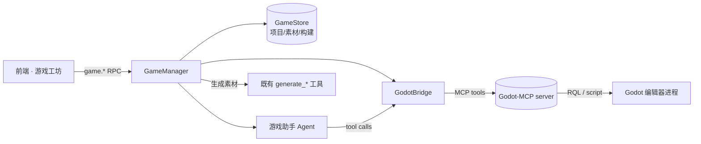

# 游戏模式（游戏工坊）——用 Godot MCP 构建可运行游戏

## 1. 设计定位与阅读说明

本文定义母仓新增「游戏模式」（UI 名「游戏工坊」）的首次落地方案：一个项目对应
一个真实 Godot 工程，AI 通过 **Godot-MCP** 驱动 Godot 编辑器完成场景、节点、
脚本与资源的创建与修改，最终导出可运行版本。阅读顺序：第 2 节看范围，第 4 节看
取舍，第 5 节看契约，第 6 节看验证计划，第 8 节看分期。

## 2. 背景、目标与范围

### 2.1 背景与问题

导演模式已证明「项目 + 素材 + 画布 + AI 对话」这套形态能承载生成式创作，但它
止步于产出素材与成片，不能产出可交互程序。游戏需要可运行的工程结构（场景树、
脚本、资源引用）、能在编辑器里被验证的修改，以及一次可交付的构建。

已核实事实（来源：Godot-MCP README 与 Godot Asset Library 5245 页面）：

- Godot-MCP 是 Godot **4.3+ 的 C#（.NET/mono）编辑器插件**，纯 GDScript 版无法
  编译；需要 **.NET 8 SDK**。
- 它以 MCP 暴露 24 个工具，分 9 族：`ping`、`rql`（`rql-query`/`rql-mutate`/
  `rql-schema`）、`script`、`screenshot`、`console`、`reflection`、
  `runtime-errors`、`session`、`skills`。
- 编辑器操作统一走 RQL：场景节点、资源、场景文件与编辑器状态共用一套查询/修改
  语言，支持批量、全成或全不成、可撤销。
- 连接方式二选一：官方托管后端 `ai-game.dev`，或**自建 MCP server**。
- 运行期可在游戏内反射调用 C# 方法并捕获运行期错误。
- 安装侧有 `godot-cli`（npm）：`create-project`、`install-plugin`、`login`、
  `setup-mcp`、`open`、`wait-for-ready`。

未核实（需在实现阶段确认）：本仓 MCP 客户端能否承载 Godot-MCP 的 stdio/HTTP
两种传输；Godot 二进制在本机与云端镜像中的可得性；`godot-cli` 对 `--headless`
导入/导出的覆盖程度。

### 2.2 目标与关键场景

| 场景 / 触发条件 | 当前行为 | 目标行为 / 可观察变化 |
| --- | --- | --- |
| 用户新建游戏项目 | 不支持 | 生成可被 Godot 打开的工程目录（`project.godot`、`scenes/`、`scripts/`、`assets/`），并写入项目记录 |
| 用户在游戏助手里描述玩法 | 不支持 | 助手经 Godot-MCP 创建/修改节点与脚本，改动以「变更集」呈现，可应用/回退 |
| 用户看素材库 | 不支持 | 角色/道具/场景/模型/贴图/音频按分类展示，可「添加到项目」 |
| 用户点「运行游戏」 | 不支持 | 启动 Godot 运行实例，回传运行日志与运行期错误 |
| 用户点「导出游戏」 | 不支持 | 产出可分发构建（首期 Web/Windows），落成项目资产 |

### 2.3 本次范围与非目标

- 本次包含：项目生命周期、Godot 工程脚手架、MCP 连接与工具代理、AI 对话式
  修改、素材库（复用生成能力）、运行日志、RPC 契约与前端工作区骨架。
- 本次不包含：多人协作与云端共享、完整 3D 建模、动画编辑器、其它引擎、
  自建 MCP 后端的鉴权体系（沿用既有 MCP 连接配置）。

### 2.4 术语与上下文

RQL＝Godot-MCP 的编辑器查询/修改语言；变更集＝一次助手轮次内对工程文件的全部
增删改，用于预览与回退；脚手架＝生成最小可运行 Godot 工程的动作。

## 3. 设计约束、假设与待决问题

- 已确认约束：导演模式的实现（`DirectorStore`/`DirectorManager`/`director.*`
  ReqMethod/前端 feature 目录）是同类形态的参考，游戏模式沿用其分层，但不复用
  其素材语义。
- 已确认约束：网关拆仓后母仓不能改 `agent_gateway` 源码，新增 `game.*` 必须经
  `jiuwenswarm/server/runtime/director/gateway_forwarding.py` 那类启动期补丁
  登记进转发集合。
- 关键假设 A1：Godot 4.3+ .NET 版与 .NET 8 SDK 可在目标环境安装；不成立时降级
  为「只生成工程文件、由用户本地打开」。
- 关键假设 A2：本仓 MCP 客户端可配置并可调用 Godot-MCP 工具；不成立时首期以
  文件级代码生成兜底。
- 待决问题 Q1：预览是嵌入前端（Web 导出 + iframe）还是拉起本机窗口？影响 P2，
  不阻塞 P0/P1。
- 待决问题 Q2：导出构建是否允许上传对象存储（复用
  `jiuwenswarm/server/runtime/director/director_cloud_url.py` 的预签名路径）？

## 4. 总体方案与设计取舍

### 4.1 方案概览

游戏模式 = 项目层（`GameProject`，对应一个 Godot 工程目录）+ 桥接层
（`GodotBridge`，把 MCP 工具封装成领域动作）+ 智能体层（游戏助手，工具循环）+
前端工作区（创作/工作流/素材/场景/代码/日志）。

箭头含义：前端只经 `game.*` RPC 访问后端；所有对 Godot 的写操作都必须经过
`GodotBridge`，以保证可预览、可回退、可审计。

### 4.2 关键决策

#### D-01 复用导演模式的分层，而非新建服务

- 选择与依据：沿用「Store（文件系统持久化）+ Manager（RPC 处理器）+ 前端
  feature 目录 + ReqMethod 运行期补齐 + 网关转发补丁」这一已验证形态。
- 代价与成立条件：需在 `message.py`、`gateway_forwarding.py`、前端导航三处
  登记；换来零新增进程与一致的可观测性。
- 实现体现：5.1/5.2 的 `GameStore`/`GameManager`，5.4 的 RPC 契约。
- 相关候选：R-01。

#### D-02 以 MCP 为唯一编辑器驱动通道

- 选择与依据：Godot-MCP 的 RQL 提供事务化、可撤销的编辑器操作，比「生成文件
  并期望 Godot 能加载」可验证性高；`screenshot`/`console`/`runtime-errors`
  提供闭环反馈。
- 代价与成立条件：强依赖 C# 版 Godot 与 .NET 8；MCP server 需可用。
- 实现体现：5.3 `GodotBridge`，6 节的连通性验证。
- 相关候选：R-02。

#### D-03 首期使用自建 MCP server，不接 ai-game.dev

- 选择与依据：对话内容与工程内容不出本环境；避免第三方账号体系。
- 代价与成立条件：需自行分发/启动 MCP server 并维护版本兼容。
- 实现体现：5.3 的连接配置与失败降级。
- 相关候选：R-03。

#### D-04 素材复用既有生成能力，工程内以文件落地

- 选择与依据：视觉/3D/音频生成已在导演模式跑通，游戏模式只负责把产物复制到
  `assets/` 并登记，避免二次实现。
- 代价与成立条件：需要「素材→工程资源」映射与重名策略。
- 实现体现：5.5 素材模型。

### 4.3 替代方案与排除理由

| 候选 / 关联决策 | 候选目的与关键差异 | 拒绝或暂缓原因 | 重新评估条件 |
| --- | --- | --- | --- |
| R-01 / D-01 独立游戏服务 | 隔离资源与崩溃域 | 新增进程与部署、可观测成本高，首期收益不足 | 游戏任务并发显著高于对话任务时 |
| R-02 / D-02 纯文件生成 | 不依赖 Godot 与 MCP | 无法在编辑器内验证，错误只能等用户打开工程才发现 | A1 不成立（Godot/.NET 装不上） |
| R-03 / D-03 ai-game.dev 托管 | 免运维 | 工程与对话离开本环境 | 合规允许且需要跨设备协作时 |
| R-04 复用导演画布做场景编辑 | 省一套 UI | 场景树/属性/脚本是工程语义，画布隐喻不匹配 | 不评估替代 |

## 5. 详细设计

### 5.1 模块责任与关键不变量

- `GameStore`：项目与素材持久化（`<root>/agent/game/projects/<id>/`），读改写
  加锁；**I1**：一条项目记录始终对应一个存在的工程目录。
- `GameManager`：`game.*` 处理器；**I2**：写工程的请求必须经 `GodotBridge` 或
  脚手架，不允许散落的直接文件写。
- `GodotBridge`：MCP 工具封装 + 可用性探测；**I3**：桥接不可用时返回结构化
  错误（`GODOT_UNAVAILABLE`），不抛未捕获异常。
- 游戏助手：对话 + 工具循环；**I4**：一次轮次产出的变更集整体可回退。

### 5.2 关键类与函数设计

| 类名 / 所属模块 | 变更类型与可见范围 | 职责与边界 | 关系 |
| --- | --- | --- | --- |
| `jiuwenswarm/server/runtime/game/game_store.py::GameStore` | 新增 / 公开 | 项目与素材持久化、目录分配 | 被 `GameManager` 组合 |
| `jiuwenswarm/server/runtime/game/game_manager.py::GameManager` | 新增 / 公开 | `game.*` 处理器 | 组合 `GameStore` + `GodotBridge` |
| `jiuwenswarm/server/runtime/game/godot_bridge.py::GodotBridge` | 新增 / 公开 | MCP 工具代理、可用性探测、脚手架 | 依赖 MCP 调用助手 |
| `jiuwenswarm/channels/web/frontend/src/features/game/*` | 新增 / 公开 | 工作区 UI 与 RPC 客户端 | 复用既有 `webRequest` |

#### GodotBridge

- 类定义：`class GodotBridge`，无基类，由 `GameManager` 持有。
- 构造与生命周期：按需探测（`probe()`），结果缓存一段时间；不长期持有进程。

| 关键方法签名 | 职责与调用条件 | 参数与返回值 | 异常与副作用 |
| --- | --- | --- | --- |
| `async probe() -> dict` | 判断 Godot 与 MCP 是否可用 | `{godot: bool, mcp: bool, version: str}` | 不抛异常，内部记录 |
| `async scaffold(project) -> list[str]` | 生成最小工程 | 创建的文件相对路径列表 | 目录已存在时幂等 |
| `async call(tool: str, args: dict) -> dict` | 代理 MCP 工具 | 原样透传结果 | 不可用时抛 `GodotUnavailable` |
| `async capture() -> bytes` | 取视口截图 | PNG 字节 | 同上 |

### 5.3 与 Godot-MCP 的契约

- 传输：优先 stdio（`godot-cli wait-for-ready` 之后），回退 HTTP。
- 工具映射：`rql-query`→读场景树/属性；`rql-mutate`→创建/修改节点与资源；
  `script`→读写 `.gd`/`.cs`；`screenshot`→预览缩略；`console`/`runtime-errors`
  →运行日志面板；`ping`→健康检查。
- 失败语义：`ping` 失败 → `GODOT_UNAVAILABLE`；工具报错 → 原样透传并落日志。

### 5.4 RPC 契约（`game.*`）

| 方法 | 语义 |
| --- | --- |
| `game.projects.list` / `create` / `get` / `rename` / `delete` | 项目生命周期 |
| `game.projects.scaffold` | 生成/修复 Godot 工程结构 |
| `game.assets.list` / `import` / `delete` | 素材库 |
| `game.files.tree` / `read` / `write` | 代码工作区 |
| `game.chat.send` | 游戏助手一轮对话（流式事件 + 变更集） |
| `game.build.run` / `status` / `export` | 运行与导出 |
| `game.bridge.status` | Godot/MCP 可用性 |

以上方法需在 `jiuwenswarm/common/schema/message.py` 运行期补齐，并在
`gateway_forwarding.py` 的转发集合中登记（与 `director.*` 同一机制）。

### 5.5 数据模型

`GameProject{project_id, name, engine:"godot", root_dir, status(draft|building|ready),
created_at, updated_at, build:{status, platform, artifact_path}, params{}}`；
`GameAsset{asset_id, type(character|prop|scene|model|texture|audio|animation),
name, file_path, params{source, prompt}}`。

## 6. 验证设计

| 验证项 | 通过条件 |
| --- | --- |
| 单元 | `GameStore` 增删改查与目录不变量；脚手架幂等；桥接不可用返回结构化错误 |
| RPC | `game.*` 全链路经网关转发成功（非 `unknown method`） |
| MCP | `game.bridge.status` 报出 godot/mcp 真实可用性；`ping` 通 |
| 端到端 | 新建项目 → 脚手架 → 助手创建角色与金币 → 运行 → 日志有帧输出 |
| 前端 | 游戏工坊入口可见，六个标签页可切换，无 pageerror |

## 7. 兼容与风险

- 兼容：新方法均为增量；老会话与导演模式不受影响。Godot/.NET 缺失时降级为
  「只生成工程」，不报致命错误。
- 风险：MCP server 版本漂移、Godot 导出模板体积大、运行进程生命周期（僵尸
  进程）、大工程读写性能。缓解：探测与超时、导出资产走对象存储、运行实例
  登记与回收。

## 8. 分期计划

- **P0（本次）**：`game.*` 契约与转发、`GameStore`/`GameManager`、脚手架、
  桥接骨架与状态查询、前端工作区骨架与导航、i18n。
- **P1**：游戏助手对话 + 变更集应用/回退；素材库导入。
- **P2**：场景树/属性/代码工作区、运行与日志、截图预览。
- **P3**：导出（Web/Windows）与分发。

## 9. 交接

移交 `jw-dev`：受影响契约为 `ReqMethod`（新增 `GAME_*`）、网关转发集合、
`server/runtime/game/*`、前端 `features/game/*` 与导航。验收场景取第 6 节；
待决问题 Q1/Q2 不阻塞 P0。
