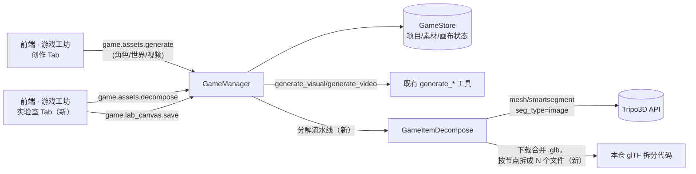

# 游戏工坊工作区重构——创作/实验室双 Tab 与素材分解能力

## 1. 设计定位与阅读说明

本文是对 [D-20261107-1637-game-mode](../D-20261107-1637-game-mode/design.md) 的**局部修订**，只改前端工作区的导航结构与素材类目，以及新增一个此前任何设计都未规划过的能力——把一张图片分解成多个独立的 3D 部件素材。该原方案里 Godot-MCP 桥接、RQL 编辑器操作、运行/导出流水线（P1-P3）不在本次变更范围内，继续按原方案推进。

阅读顺序：第 2 节看问题与范围（含已核实的现状事实）；第 3 节看设计约束与假设（Q1-Q4 均已在评审中确认）；第 4 节看关键取舍；第 5 节看详细设计；第 8 节看验证计划；第 10 节看评审记录。

## 2. 背景、目标与范围

### 2.1 背景与问题

已核实事实（逐条标注来源，均来自直接读取当前代码）：

- 游戏工坊当前是 6 个标签页：创作/工作流/素材/场景/代码/日志，整个工作区是一个 493 行的单文件组件（`GamePage.tsx:21-30` 定义 6 个 tab），没有拆成子组件，也没有用仓库共享的 UI 组件库，和导演模式 `features/director/components/` + `features/director/lab/` 的拆分方式差距很大。
- "创作"标签目前只是一张简单表单：选素材类型 + 填提示词 + 点生成（`GamePage.tsx:293-334`）。后端 `handle_game_assets_generate`（`game_manager.py:157-201`）无论选的是哪个类型，**永远只调用 `generate_visual`**（2D 图片生成），`model`/`texture`/`animation`/`audio` 这几个类型从诞生起就只是贴在一张 2D 图上的标签，没有真正的生成路径。
- "素材"标签是按 `ASSET_GROUPS`（`GamePage.tsx:40-48`：角色/道具/场景/模型(3D)/纹理/音频/动画，共 7 类）分组的纯文字列表，没有缩略图，没有画布，没有拖拽。
- 游戏工坊目前没有任何画布/节点图形态的界面，没有 React Flow，没有"节点""连线"的概念。
- 导演模式实验室画布的真实"一对多"机制（`outputCount`，`labTypes.ts:188`；克隆逻辑 `LabCanvas.tsx:795-842`）是"同一份输入、同一组参数，并发发起 N 次**完全相同**的生成请求，各自产出一份独立结果"，不是"一次生成，产出 N 个不同的具名素材"。后者正是游戏工坊"把一张图分解成多个不同部件"想要的语义，在当前两种模式里都不存在，需要全新设计。
- 导演模式的"世界"类目目前是**禁用占位**：`DirectorAssetType`（`types.ts:4`）的实际联合类型里没有 `world`；`ComposerMode`（`types.ts:55`）虽然列出了 `world`，但 `ENABLED_COMPOSER_MODES`（`types.ts:57`）明确把它排除；`ModeSegmentedControl.tsx:10,17,22` 把"世界"按钮渲染成灰态不可点。也就是说"世界"目前只有一个 i18n 文案和一个按钮位置，没有资产类型、没有生成路径、没有存储字段——不是一个可以直接照搬复用的成熟模式。
- 仓库里没有任何 3D 生成/图片转模型/Tripo3D 集成，`config_set_handlers.py:180-201` 枚举的生成类配置 slot 只有 `VIDEO_GEN_*`/`VISUAL_GEN_*`/`AUDIO_GEN_*`/`EDIT_CHAT_*`，没有第五类。
- 用户最初给出的 Tripo3D 文档（`image-to-multiview`）抓取后确认：该端点产出的是**同一个主体的四个视角图**（front/left/back/right），**不是**把一张图拆成多个不同物体，不适合直接拿来当分解能力。评审中用户改指向 `generation/image-to-model`（H 系列），抓取后发现它带一个 `generate_parts` 选项，但官方文档没有给出开启后响应体的示例（无 parts 数组/命名字段说明）；继续顺着文档站点的侧边栏核实 `Smart Segmentation`（`/mesh/smartsegment`）、`Segmentation`（`/mesh/segment`）、`Task Query` 三个相关页面后，确认了一个更站得住脚的事实：**Tripo3D 所有"分割"类端点（`mesh/segment`、`mesh/smartsegment`）在文档示例里都只返回单个 `model_url`（一个合并的 `.glb`），不是多个独立文件**；`smartsegment` 额外支持 `seg_type=image`（可以直接对原始图片操作，不需要先转成 3D 模型）、`hint`（文字提示引导要分割出哪些部件，例如直接喂"weapon, belt, necklace, head, hair, legs, torso, pants, shirt"）和 `granularity`（`coarse`/`medium`/`fine`），返回体里除了 `model_url`，还有一个 `prompt` 字段（逗号分隔的部件名称字符串，示例是 `"head, body, left arm, right arm, legs"`）和一个 `mask_url`（2D 分割遮罩预览图）。换句话说，Tripo3D 一侧能确认的事实是"一次调用产出一个内部已经按部件分开的合并模型 + 部件名称字符串"，**不是**"一次调用产出 N 个独立可下载文件"——后者需要本仓自己解析这一个 `.glb` 的 glTF 场景图，把其中已经分开的节点/网格导出成 N 个独立文件，这是一段全新的、仓库里目前没有对应能力的代码（见 D-04、A1）。用户参考的 assethub.io 截图（"Copy of [Public] Theron"）展示的"一张角色图 → 匕首/腰带/项链/光头/头发/腿×2/躯干/裤子/上衣共 12 个独立部件缩略图"，只作为 UI 形态参考，其内部具体用了 Tripo3D 的哪个端点、是否也经过了类似的"合并模型再拆分"步骤，无法核实（登录墙后不可见）。

推断、未核实：assethub.io workflow 71047 的页面在登录墙后面，无法直接核实其内部实现，本文只把截图当作 UI 形态参考（节点图：1 个来源节点 + 1 张生成参数卡 + N 个部件缩略图，虚线连接），不作为技术实现依据。

### 2.2 目标与关键场景

| 场景 / 触发条件 | 当前行为 | 目标行为 / 可观察变化 |
| --- | --- | --- |
| 用户打开游戏工坊 | 看到 6 个标签页：创作/工作流/素材/场景/代码/日志 | 只剩创作/实验室两个标签；工作流/场景/代码/日志本次直接下线（评审已确认，见 Q1） |
| 用户在创作 Tab 生成角色概念图 | 选"角色"类型生成一张 2D 图，归入"角色"类目 | 行为不变，继续归入"角色"类目 |
| 用户想要场景/环境/道具类的概念图 | 要在"道具""场景"两个类目之间自己判断该选哪个 | 概念图统一归入"世界"类目生成（评审已确认，见 Q2）；"道具"作为概念 没有消失，它变成分解流水线产出的具体部件类型（`model_part`），不再是一个独立的生成按钮 |
| 用户想为游戏做一段视频素材（预告/过场） | 不支持，没有任何视频生成入口 | 新增"视频"类目，复用 `generate_video`，与导演模式视频生成同构 |
| 用户有一张角色/道具合集图（自己生成或上传），想拆成可独立使用的 3D 部件 | 不支持 | 在实验室画布把图片接入"素材分解"卡片，产出 N 个独立的 3D 部件素材，各自可下载/重命名/删除 |

### 2.3 本次范围与非目标

本次包含：

- 前端导航收敛为"创作"与新增的"实验室"两个标签；工作流/场景/代码/日志四个旧标签直接下线（评审已确认，见 Q1）。
- 创作 Tab 的素材类目从 7 个（角色/道具/场景/模型/纹理/音频/动画）收敛为 3 个：角色/世界/视频；"视频"类目接通真实的 `generate_video` 路径（此前完全不存在）。
- 新增实验室 Tab：React Flow 画布，新增处理卡片"素材分解"，实现"1 张图片 → N 个独立 3D 部件素材"（输入图片沿用既有 `generate_visual`/已有素材；3D 侧调用 Tripo3D `mesh/smartsegment`，`seg_type=image` 产出一个内部已分部件的合并模型，再由本仓新代码拆分成 N 个独立 `.glb`）。
- 新增 Tripo3D 配置 slot、后端分解流水线模块（含 glTF 拆分逻辑）、游戏项目数据模型扩展（`lab_nodes`/`lab_edges`、素材间的分解血缘字段、分解批次字段）。

本次不包含：

- Godot-MCP 桥接、RQL 编辑器操作、运行/导出流水线（D-20261107-1637 的 P1-P3，继续按原方案推进）。
- 游戏助手对话（`game.chat.send`，原设计 P1，未实现，本次不涉及）。
- "道具"作为独立的创作生成按钮（评审已确认折入"世界"，见 Q2、D-02）；"音频""动画"的真实生成能力（非目标，未来再议）。
- 原来的工作流/场景/代码/日志四个标签所承载的能力（Godot 场景树编辑、代码工作区、运行日志）——本次随标签一起下线，不迁移到创作/实验室；待 Godot-MCP 在 P1/P2 真正接通时，按当时需要重新设计入口，不在本设计预先占位。
- assethub.io 工作流 71047 的完整复刻（内部实现不可核实，只借鉴 UI 形态）。
- 分解出的 3D 部件实际导入 Godot 工程、在场景里使用——本次验证范围只到"产出可下载的 .glb 文件"。

### 2.4 术语

- **分解（decompose）**：把一张图片经 Tripo3D `mesh/smartsegment`（`seg_type=image`）生成一个内部已分部件的合并模型，再由本仓代码把该模型按部件拆成多个独立文件的动作，对应实验室里的"素材分解"处理卡片。
- **部件素材（item asset）**：分解产出的单个 3D 模型文件（`.glb`），带缩略图，归属某个"源素材"与某个"分解批次"。
- **源素材（source asset）**：被分解的输入图片，须是"角色"或"世界"类目下状态为 `ready` 的素材，或新上传的图片。
- **分解批次（decompose batch）**：同一次"点击分解"产出的一组部件素材的共同标识（`decompose_batch_id`），用于整批删除/区分多次重新分解的结果（见 Q4、5.4）。

## 3. 设计约束、假设与待决问题

**已确认约束**：

- 沿用 D-20261107-1637-game-mode 的分层约束（`GameStore` 文件系统持久化 + `GameManager` 处理器 + 前端 feature 目录 + `ReqMethod` 运行期补齐 + `gateway_forwarding.py` 登记转发），本次新增的 RPC/字段同样要走这一套机制，不新开进程、不绕过转发集合。
- 新的 3D 生成凭据必须走独立配置 slot（仿照 `VIDEO_GEN_*`/`VISUAL_GEN_*` 的样子），不能复用图片/视频生成的 slot——否则用户换掉图片生成供应商会连带破坏 3D 分解功能。

**关键假设**：

- A1：`mesh/smartsegment`（`seg_type=image`）返回的 `prompt` 字符串（逗号分隔的部件名称，如 `"head, body, left arm, right arm, legs"`）里列出的部件名，与 `model_url` 这个合并 `.glb` 内部实际的节点/网格命名能对应上（至少数量一致、顺序一致），从而让本仓的拆分代码能把"第 N 个节点"正确标注成"第 N 个部件名"。官方文档没有给出这一层对应关系的说明，只能在实现阶段用真实凭据跑一次、实际打开返回的 `.glb` 核对节点命名来确认；对应不上时退化为"按节点顺序编号，不强行套用 `prompt` 里的名字"，不影响拆分本身能不能产出独立文件。
- A2：Tripo3D 产出的 `.glb` 可以直接作为 Godot 工程的导入资源（Godot 4.x 原生支持 glTF 2.0 导入）；本次不验证这一步，列为已知限制（见 9.2）。
- A3：本仓需要新增一个 glTF 解析/拆分的 Python 依赖（例如 `pygltflib` 或 `trimesh`，具体选型留给实现阶段），用于把 `smartsegment` 返回的单个合并 `.glb` 按节点拆成多个独立文件；这是一个新的第三方依赖面，需要在 `pyproject.toml` 登记并确认许可证兼容。

**待决问题**（Q1-Q4 均已在评审中确认，详见 10 节评审记录）：

- ~~**Q1**：工作流/场景/代码/日志四个旧标签何去何从？~~ **已确认（2026-11-16）**：直接下线，不保留、不迁移，待 Godot-MCP 真正接通时按当时需要重新设计。
- ~~**Q2**："道具"类目的去向？~~ **已确认（2026-11-16）**：作为创作 Tab 的生成按钮，"道具"折入"世界"（画道具概念图走世界类目，不单独开一个按钮）；但"道具"作为一种对象语义没有消失——分解流水线产出的部件（剑、腰带等）在数据层面就是道具，只是不再对应"世界/角色/视频"里的某个生成入口，而是对应新的 `model_part` 类型（见 Q3）。
- ~~**Q3**：实验室"素材分解"产出的部件素材，类型标成什么？~~ **已确认（2026-11-16）**：`model_part`——用一个通用名称同时覆盖"道具类部件"（武器/腰带/项链）和"身体部位类部件"（头/发/腿/躯干），不单独为道具类部件起 `prop_part` 这样的名字，避免身体部位被错误归类成"道具"。
- ~~**Q4**：重新对同一张源图跑分解，覆盖旧结果还是追加？~~ **已确认（2026-11-16）**：追加，但同一次分解产出的所有部件共享一个 `decompose_batch_id`（见 2.4、5.4），可以整批删除，不必逐个点掉失败/不想要的那一批；与导演模式"重新生成不覆盖历史"的既有习惯保持一致，同时避免像单资产重生成那样零散堆积——这里一次分解会产生多个资产，又是真实计费的外部调用（`smartsegment` 示例响应里 `credits_consumed` 为 85），比普通重新生成更需要"按批次清理"这个粒度。

## 4. 总体方案与设计取舍

### 4.1 方案概览

游戏工坊工作区 = 创作 Tab（角色/世界/视频三类生成+浏览，复用导演模式 `DirectorRail` 的交互范式）+ 实验室 Tab（React Flow 画布，新增"素材分解"处理卡片，调用新的 Tripo3D 分解流水线）。后端新增 `game_item_decompose.py`（Tripo3D 客户端 + 分解编排），`GameStore`/`GameProject` 扩展 `lab_nodes`/`lab_edges` 与素材血缘字段，`GameManager` 新增三个处理器。

箭头含义：创作 Tab 只触达既有生成工具（不新增后端生成能力，只是把现有能力重新归类展示）；实验室 Tab 的"素材分解"是本次唯一新增的后端生成能力，封装在独立的 `GameItemDecompose`，不直接耦合进 `GameManager`，便于单测和未来替换供应商。

### 4.2 关键决策

#### D-01 创作/实验室两段式导航，复用导演模式的职责划分而非照搬其组件；工作流/场景/代码/日志直接下线

- 选择与依据：导演模式已验证"创作=生成+浏览合一的素材库，实验室=可编排的处理流程画布"对多媒体生成场景成立；游戏工坊的素材生成（2D 概念图）与分解（3D 部件产出）正好对应这两种职责——前者"产出单个素材"，后者"把素材继续加工成一组新素材"。用户在评审中已确认（Q1，2026-11-16）：工作流/场景/代码/日志四个旧标签直接下线，不保留、不迁移进创作/实验室。
- 代价与成立条件：游戏工坊目前的"创作/素材"两个旧标签要合并（素材浏览并入创作）；工作流的静态步骤说明、场景树占位、代码编辑器、日志占位这四块能力随之整体消失，Godot-MCP 在 P1/P2 真正接通前，游戏工坊没有任何场景编辑/代码查看入口（见 2.3 非目标、7 节兼容性）。
- 实现体现：5.1 模块职责，5.5 前端模块变更，6.1 实施项。
- 相关候选：R-01。

#### D-02 "世界"类目重新定义为环境/场景概念图，不等待导演模式把它做成正式功能；"道具"折入其中

- 选择与依据：导演模式的"世界"目前只是禁用占位（`types.ts:55,57`；`ModeSegmentedControl.tsx` 渲染为灰态按钮），没有可复用的后端语义。游戏工坊需要的"世界"（场景/环境概念图）与导演模式未来打算做的"世界"不一定是同一件事；与其等待一个没有时间表的功能，不如现在就为游戏工坊定义一套真实可用的语义，只借用"世界"这个名字和 UI 位置上的一致性。用户已确认（Q2，2026-11-16）：原"道具"类目作为创作生成按钮折入"世界"——画一张道具概念图和画一张场景概念图不需要分开两个按钮；"道具"作为对象语义不消失，它体现在分解流水线产出的 `model_part` 素材上（见 D-05）。
- 代价与成立条件：两边"世界"名字相同但语义不保证一致，未来导演模式真正实现"世界"时需要重新核对是否要统一（不在本次范围内）。
- 实现体现：5.4 数据模型。
- 相关候选：R-02。

#### D-03 视频类目直接复用 `generate_video`，不等 Godot-MCP 落地

- 选择与依据：`generate_video` 是独立于 Godot-MCP 的既有工具（导演模式已验证），游戏工坊加一个"视频"类目只是多一条 `asset_type` 分支，和 Godot-MCP 进度无关。
- 代价与成立条件：产出的视频素材本次只是"存在项目里的一个文件"，不接入 Godot 工程播放——那是 Godot-MCP 落地后的事。
- 实现体现：5.2 `GameManager.handle_game_assets_generate` 的分支扩展。

#### D-04 素材分解走 Tripo3D `mesh/smartsegment`（`seg_type=image`）单次调用，产物再由本仓代码拆成 N 个文件

- 选择与依据：源图片不需要新建一套生成路径——复用既有 `generate_visual`（角色/世界类目本来就是这样生成的，或者用户直接上传）。3D 分解部分，核对了 Tripo3D 文档站点里所有跟"分割/多部件"相关的页面（`image-to-model` 的 `generate_parts`、`mesh/segment`、`mesh/smartsegment`、`Task Query`）后确认：这些端点在文档示例里**全部只返回一个合并的 `model_url`**，没有一个会直接给出"N 个独立文件"。其中 `mesh/smartsegment` 是最合适的一个——可以直接对图片操作（`seg_type=image`，不需要先转成 3D 模型），还能用 `hint` 文字引导分割依据（可以直接喂装备槽位词表），并在响应里给出一个 `prompt` 字段列出识别到的部件名称。采用它作为唯一的 3D 侧调用，本仓自己新增一段 glTF 解析代码，把返回的这一个合并 `.glb` 按内部节点/网格拆成 N 个独立文件，各自落成一个 `GameAsset`（见 A1、A3）。
- 代价与成立条件：比最初设想的"调一个 API 直接拿到 N 个文件"多一层本仓自己的实现（glTF 拆分），不是纯粹的"转发 Tripo3D 的输出"；拆分出来的部件叫什么名字依赖 A1（`prompt` 字符串与 `.glb` 内部节点命名能否一一对应）是否成立，对不上时退化为按顺序编号命名，不影响"产出 N 个独立文件"这个核心目标。
- 实现体现：5.2 `GameItemDecompose.decompose`，5.7 正常执行流程。
- 相关候选：R-03、R-05。

#### D-05 分解产出的部件素材使用独立类型 `model_part`，不复用旧的 `model`；覆盖道具与身体部位两类产出

- 选择与依据：`GAME_ASSET_TYPES` 里的 `model` 从诞生起就从未被真正的 3D 生成路径使用过（和其他 6 个类型一样被塞进 `generate_visual`，产出一张贴着"模型"标签的 2D 图）。继续用它会让"真·3D 模型"和"过去那个从来没真正 3D 过的占位"混在一起，无法区分数据可信度。用户已确认（Q3，2026-11-16）：用通用的 `model_part` 而不是更具体的 `prop_part`，因为分解一张角色图既可能产出道具类部件（武器、腰带），也可能产出身体部位类部件（头、腿、躯干）——后者套"道具"的名字在语义上说不通。
- 代价与成立条件：旧项目里 `type=model` 的旧素材（实际是 2D 图）在 UI 上要和新的真 3D 部件区分显示（见 7 节兼容性）。
- 实现体现：5.4 数据模型。

#### D-06 同一次分解产出的所有部件共享一个 `decompose_batch_id`，重新分解默认追加而非覆盖

- 选择与依据：用户已确认（Q4，2026-11-16）：重新对同一张源图跑分解，默认追加新的一组部件，不覆盖旧结果，这与导演模式"重新生成不覆盖历史"的既有习惯一致，不需要给用户一个新概念。但分解和导演模式里"重新生成一张图/一段视频"不一样——一次分解会产出**多个**资产，而且是真实计费的外部调用（`smartsegment` 示例响应里 `credits_consumed` 为 85），不追加分组标识的话，反复试验几次就会在素材库里留下一堆无法批量区分、也无法整批清理的部件。所以加一个 `decompose_batch_id`，同一批产出的部件共享同一个值，前端可以按批次整批删除。
- 代价与成立条件：需要在 `GameAsset` 上多存一个字段，素材列表/实验室画布在展示部件时要能按 `decompose_batch_id` 分组（而不仅仅是按 `source_asset_id` 分组——同一个源素材可能被分解很多次，各自是独立的批次）。
- 实现体现：5.4 数据模型，5.7 正常执行流程，8 节 V-06。

### 4.3 替代方案与排除理由

| 候选 / 关联决策 | 候选目的与关键差异 | 拒绝或暂缓原因 | 重新评估条件 |
| --- | --- | --- | --- |
| R-01 / D-01 维持六标签，只在"素材"标签加一个"分解"按钮 | 改动面最小 | 不满足用户明确提出的"创作+实验室两个 Tab"诉求 | 不评估 |
| R-02 / D-02 等导演模式做完"世界"再跟进，本次沿用"场景"旧名 | 两边"世界"语义统一 | 导演模式"世界"没有时间表，游戏工坊等不起 | 导演模式"世界"正式落地且语义与本提案冲突时 |
| R-03 / D-04 只用 `image-to-multiview` 当分解结果 | 省掉任何 3D 生成调用 | 产出仍是同一主体的 4 个视角图，不是独立部件，不满足"拆成独立道具"的诉求，和 assethub.io 截图展示的效果不是一回事 | 不评估 |
| R-05 / D-04 用 `image-to-model` 的 `generate_parts=true` 而不是 `mesh/smartsegment` | 用户最初指向的就是 `image-to-model` | `generate_parts` 的响应体结构完全没有文档说明（连一个合并模型的示例都没给），而 `mesh/smartsegment` 至少有示例响应（`model_url`/`prompt`/`mask_url`），且能直接对图片操作、能用 `hint` 引导分割依据，确定性更高 | 实现阶段如果 `smartsegment` 效果不理想，可以把 `generate_parts` 作为并行尝试的另一个输入源（两者产物形态相同，都是"一个合并 `.glb`"，走同一套拆分代码） |
| R-04 / D-04 用通用 VLM 把图片按坐标框裁剪成若干张 2D 图，完全不调用任何 3D API | 不依赖 Tripo3D，成本低 | 产出仍是 2D 裁剪图，不是可独立使用的 3D 部件模型 | 用户确认只需要 2D 裁剪而非真 3D 部件时 |

## 5. 详细设计

### 5.1 模块责任与关键不变量

- `GameManager`（扩展）：新增 `handle_game_assets_decompose` / `handle_game_assets_decompose_check_status` / `handle_game_lab_canvas_save`。**I5（新增不变量）**：分解任务产出的每个部件素材必须记录 `source_asset_id` 指回被分解的源素材、`decompose_batch_id` 指回这一次分解的批次，不允许孤儿部件素材（见 D-06）。
- `GameItemDecompose`（新增模块，`jiuwenswarm/server/runtime/game/game_item_decompose.py`）：Tripo3D 客户端（`mesh/smartsegment`，`seg_type=image`）+ glTF 拆分（见 D-04、A3）。**I6**：供应商不可用或凭据未配置时返回结构化 `NOT_CONFIGURED`，不抛未捕获异常（与 `GodotBridge.probe` 的既有风格一致）。
- `GameStore`（扩展）：`GameProject` 新增 `lab_nodes`/`lab_edges`（镜像 `DirectorProject`），`GameAsset` 新增 `source_asset_id: str | None`、`decompose_batch_id: str | None`。

### 5.2 关键类与函数设计

| 类名 / 所属模块 | 变更类型 | 职责与边界 | 关系 |
| --- | --- | --- | --- |
| `game_item_decompose.py::GameItemDecompose` | 新增 / 公开 | Tripo3D 分解编排（`smartsegment` 调用 + glTF 拆分） | 被 `GameManager` 组合 |
| `game_manager.py::GameManager` | 修改 | 新增处理器方法 | 新增持有 `self._decompose = GameItemDecompose()` |
| `game_store.py::GameProject` | 修改 | 新增 `lab_nodes`/`lab_edges` | 与 `DirectorProject` 同构 |
| `game_store.py::GameAsset` | 修改 | 新增 `source_asset_id`、`decompose_batch_id` | — |

#### GameItemDecompose

- 类定义：`class GameItemDecompose`，无基类。
- 构造与生命周期：无状态，每次调用时现读配置（`TRIPO_API_KEY`/`TRIPO_API_BASE`），与 `video_understanding` "每次调用前先刷新配置"的风格一致，不长期持有连接。

| 关键方法签名 | 职责与调用条件 | 参数与返回值 | 异常与副作用 |
| --- | --- | --- | --- |
| `async def configured() -> bool` | 判断凭据是否齐全 | 无参数；返回是否可用 | 不抛异常 |
| `async def decompose(image_path: str, *, hint: str \| None = None, granularity: str = "medium") -> str` | 提交一次 `mesh/smartsegment`（`seg_type=image`），轮询到完成；下载返回的单个合并 `.glb`，解析其 glTF 场景图，把每个顶层节点/网格导出成独立的 `.glb` 文件，尽量按 `prompt` 字段给出的部件名顺序对应命名（A1 对不上时按顺序编号） | `image_path`：本地文件路径；`hint`：引导分割依据的文字（如装备槽位词表）；返回值与既有 `generate_video`/`generate_visual` 一致的字符串约定（成功：`Saved to: ...` 列表，每行一个部件文件；失败：`[ERROR]: ...`），由调用方解析 | 任一阶段失败返回 `[ERROR]: ...` 字符串，不抛异常，与仓库既有生成工具的错误约定保持一致；glTF 解析失败（文件损坏、无法识别的节点结构）同样返回 `[ERROR]: ...`，不抛未捕获异常 |

### 5.3 接口定义（RPC 契约，追加到 `game.*`）

| 方法 | 语义 |
| --- | --- |
| `game.assets.decompose` | 提交分解任务：`{project_id, source_asset_id}` → `{project, job_id}` |
| `game.assets.decompose_check_status` | 轮询分解任务；完成后把各部件落成 `GameAsset` 并登记 `source_asset_id` |
| `game.lab_canvas.save` | `{project_id, nodes, edges}` → `{project}`，与 `director.lab_canvas.save` 同构 |

同样需要在 `message.py` 补齐 `ReqMethod`、在 `gateway_forwarding.py` 登记转发（与 D-20261107-1637 D-01 的约束一致）。

### 5.4 数据模型变更

- `GameAsset` 新增字段：
  - `source_asset_id: str | None = None`（分解产出的部件指回源图；非分解产出则为 `None`）。
  - `decompose_batch_id: str | None = None`（同一次分解调用产出的所有部件共享同一个值，供整批删除/区分多次分解结果，见 D-06）。
- `GAME_ASSET_TYPES` 由 `(character, prop, scene, model, texture, audio, animation)` 调整为 `(character, world, video, model_part)`：`prop`/`scene` 折入 `world`，`model`/`texture`/`animation` 下线，`audio` 本次不做，`model_part` 新增（均已评审确认，见 Q2/Q3）。
- `GameProject` 新增 `lab_nodes: list[dict]`、`lab_edges: list[dict]`（与 `DirectorProject` 同构）。

### 5.5 前端模块变更

- `GamePage.tsx` 拆分为 `features/game/` 下多个文件（镜像 `features/director/components/` + `features/director/lab/` 的目录结构），不再是单文件：
  - `GameRail.tsx`（镜像 `DirectorRail`）：创作 Tab 的素材分类（角色/世界/视频）+ 生成表单 + 素材网格。
  - `lab/GameLabCanvas.tsx`（镜像 `LabCanvas`）：React Flow 画布，新增节点类型 `model`（3D 部件缩略图占位渲染）与新处理卡片 `decompose`。
  - `lab/nodes/ModelNode.tsx`（新增）：渲染 `rendered_image_url` 预览图 + 下载/导入工程按钮；是否需要交互式 3D 查看器（例如 `<model-viewer>`）本次先用静态渲染图占位（见 9.2）。
- `gameApi.ts` 新增 `decomposeAsset`/`checkDecomposeStatus`/`labCanvasSave` 方法。

### 5.6 配置与能力控制

新增设置 slot `TRIPO_API_KEY`/`TRIPO_API_BASE`/`TRIPO_ENABLED`，走既有 `envField('agent', ...)` 机制（`settingsContract.ts`），与 `VIDEO_GEN_*`/`VISUAL_GEN_*` 同构。用户已在本次会话里口头提供了真实的 Tripo3D API Key；该凭据**不写入本设计文档，也不提交到仓库**，实现阶段直接写进本机 `~/.jiuwenswarm/config/.env` 的 `TRIPO_API_KEY`。

### 5.7 正常执行流程（素材分解）

1. 用户在实验室画布拖入一张"角色"或"世界"类目下已就绪的图片素材（或上传新图），接到"素材分解"处理卡片的输入端口；可选填一段 `hint` 文字引导分割依据（如装备槽位词表）。
2. 点击"分解"，前端调 `game.assets.decompose`；后端校验源图存在、Tripo3D 已配置，生成一个新的 `decompose_batch_id`，提交 `mesh/smartsegment`（`seg_type=image`，走 `GameItemDecompose.decompose`），创建一个 `status=pending` 的聚合占位素材（此时还不知道确切会分出几个部件）。
3. 轮询 `game.assets.decompose_check_status`：任务完成后下载返回的单个合并 `.glb`，按 glTF 场景图拆成 N 个独立文件，尽量用 `prompt` 字段给出的名字命名（对不上时按顺序编号，见 A1），各自落成一个 `type=model_part`、`source_asset_id=<源图 asset_id>`、`decompose_batch_id=<本批次 id>` 的 `GameAsset`。
4. 前端画布把占位聚合节点替换成 N 个独立的 `model` 节点，各自可重命名/下载/删除；这一批部件在素材列表里按 `decompose_batch_id` 分组展示，支持整批删除（见 D-06）。

### 5.8 异常处理

- 凭据未配置：返回 `NOT_CONFIGURED`，前端提示去设置页配置"3D 分解"。
- `mesh/smartsegment` 调用阶段失败：不产出任何部件素材，占位节点标记失败，可重试（重试会产生一个新的 `decompose_batch_id`，不复用失败的那个）。
- glTF 拆分阶段失败（下载成功但解析/拆分出错）：合并后的单一 `.glb` 本身先保留（可以手动下载查看），不强行拆出任何部件；错误信息里带上具体的解析失败原因，便于定位是 Tripo3D 返回的文件有问题还是本仓拆分代码的问题。
- 重复提交：与 `generate_video` 既有约定一致，每次点击分解都是独立的新调用，各自一个新的 `decompose_batch_id`，不做幂等去重（见 D-06、Q4）。

## 6. 影响面与实施设计

### 6.1 修改点与实施顺序

| 实施项 | 模块 / 文件 | 修改内容与责任 | 必要前置 |
| --- | --- | --- | --- |
| I-01 | `message.py`, `gateway_forwarding.py` | 新增 3 个 `game.*` `ReqMethod` 并登记转发 | 无 |
| I-02 | `game_store.py` | `GameAsset.source_asset_id`/`decompose_batch_id`、`GameProject.lab_nodes`/`lab_edges`、`GAME_ASSET_TYPES` 调整 | I-01 |
| I-03 | `game_item_decompose.py`（新文件）、`pyproject.toml` | Tripo3D `smartsegment` 客户端 + glTF 拆分（新增 glTF 解析依赖，见 A3） | 无 |
| I-04 | `game_manager.py` | 新增 3 个处理器方法 | I-02, I-03 |
| I-05 | `settingsContract.ts`, `config_set_handlers.py` | `TRIPO_*` 设置 slot | 无 |
| I-06 | `features/game/*`（拆分重构） | `GameRail`/`GameLabCanvas`/`ModelNode`；导航收敛为创作+实验室，移除工作流/场景/代码/日志四个旧标签及其组件 | I-04, I-05 |
| I-07 | `gameApi.ts` | 新增 3 个 RPC 客户端方法 | I-01 |

实施顺序：I-01 → I-02/I-03（可并行）→ I-04 → I-05（可并行于 I-04）→ I-07 → I-06（前端依赖后端契约先行）。

### 6.2 文档同步

- spec：目前没有独立的 `game.*` 契约 spec；本次新增的 RPC 契约暂记在本设计 5.3，若后续沉淀为稳定契约再建 S 文档。
- 架构：不需要调整 AGENTS.md（沿用既有分层约束）。
- 开发计划：待 `jw-dev` 建 F 文档时登记。

## 7. 兼容与迁移

- 影响对象：已有游戏项目里 `type=model/texture/animation/prop/scene` 的旧素材（实际都是贴着旧标签的 2D 图）。
- 处理策略：旧素材保留在存储里不删除，只是新的素材分类展示列表里不再有对应入口——需要在素材列表加一个"其他/历史"兜底分类，避免旧素材变成界面上找不到的孤儿。这是本提案新增的隐性需求，不在用户原始描述里，列入 9.2 已知限制，评审时确认是否要做。
- 回退边界：本次改动不涉及不可逆的数据删除；可以随时把前端导航改回旧结构、`GAME_ASSET_TYPES` 改回旧七类，已落盘的数据不受影响。

## 8. 验证设计与通过条件

| 验证 ID | 场景 / 前置状态与输入 | 操作或验证入口 | 预期结果 / 通过条件 | 验证层级与环境 |
| --- | --- | --- | --- | --- |
| V-01 | 创作 Tab 分别生成角色/世界/视频三类素材 | 实际调用 `game.assets.generate` | 三类都生成成功；视频类目产出可播放的 mp4 | 端到端 |
| V-02 | 实验室拖入一张角色图跑分解 | 实际调用 `game.assets.decompose` + `check_status`（真实 Tripo3D 凭据） | 产出 ≥2 个 `type=model_part` 素材，各自 `source_asset_id` 指回源图、`decompose_batch_id` 一致，`.glb` 可下载且是有效 glTF | 端到端，真实外部调用 |
| V-03 | `TRIPO_API_KEY` 未配置时跑分解 | 清空凭据后调用 | 返回 `NOT_CONFIGURED`，不产出孤儿素材 | 单测 / 模拟 |
| V-04 | `smartsegment` 调用成功但 glTF 拆分阶段失败（构造一个无法解析的 `.glb`） | 模拟拆分代码抛出解析错误 | 不产出任何部件素材；原始合并 `.glb` 保留可下载；不崩溃、不留半成品 | 单测 / 模拟 |
| V-05 | 旧项目（`type=model` 等旧类目）在新 UI 下仍可见 | 打开一个旧素材齐全的项目 | 旧素材出现在兜底分类，不报错、不丢失 | 回归 |
| V-06 | 对同一张图跑两次分解，删除第一批 | 实际调用两次 `game.assets.decompose`，再按 `decompose_batch_id` 删除第一批 | 第一批的所有部件被整批移除，第二批不受影响 | 端到端 |

## 9. 设计风险与已知限制

### 9.1 设计风险

| 风险 / 触发条件 | 对本次方案的影响 | 已有应对措施 | 核实或验证方式 |
| --- | --- | --- | --- |
| `smartsegment` 的 `prompt` 字符串与 `.glb` 内部节点命名的对应关系未文档化（A1） | 拆分出来的部件文件可能起不出有意义的名字，退化为顺序编号 | 5.2 已把"对不上就按顺序编号"写成明确的降级路径，不影响"产出 N 个独立文件"这个核心目标 | 用真实凭据对一张测试图调用一次，下载 `.glb` 实测打开核对节点命名 |
| `mesh/smartsegment` 即使按 `hint` 分割，产出的部件也可能不是"武器/护甲/头发"这种有意义的装备槽位切分，而是粗糙的几何连通性切分 | 达不到用户参照 assethub.io 截图的真实诉求 | `hint`/`granularity` 参数留作可调；若效果不理想，可并行尝试 `image-to-model` 的 `generate_parts`（同样产出一个合并 `.glb`，走同一套拆分代码，见 4.3 R-05） | 用同一张测试图分别跑不同 `hint`/`granularity` 组合，比较部件的实际可用性 |
| 新增的 glTF 解析依赖（A3）引入额外的第三方库维护成本，具体库未选型 | 增加一个新的依赖面，需要走仓库现有的依赖登记与许可证核对流程 | 6.1 已把依赖登记列为 I-03 的一部分 | 实现阶段按仓库现有第三方依赖引入流程核对 |
| `.glb` 导入 Godot 工程的实际效果未核实（A2） | 分解出的部件可能无法直接用于游戏工程，削弱该功能在"游戏工坊"场景下的实际价值 | 本次验证范围只到"产出可下载的 `.glb`" | P1/P2 阶段接通 Godot-MCP 后实测 |

### 9.2 已知设计限制

- 本次不提供交互式 3D 预览（仅渲染图缩略图），要转一圈看模型需下载后用外部工具打开。
- 旧素材类型的 UI 兜底展示方案只是本提案的建议，不是用户已确认的需求，需评审时确认是否要做（见 7 节）。
- 分解流水线产出的部件数量、命名很大程度依赖 Tripo3D 返回的切分质量与 `prompt`/节点命名的对应关系，本设计不做二次人工校正（命名对不上时退化为顺序编号，见 A1）。

## 10. 按日期记录的评审与设计修订

| 日期 | 评审人 / 确认方 | 评审或修订主题 | 结论 | 修改与依据 |
| --- | --- | --- | --- | --- |
| 2026-11-16 | — | 初稿成文 | 待用户确认 Q1-Q4 | — |
| 2026-11-16 | alexbhyeo | Q1（工作流/场景/代码/日志四个旧标签去留）；分解管线应该用哪个 Tripo3D 端点 | Q1：四个标签直接下线，不保留不迁移。管线：改用 `generation/image-to-model`（`generate_parts=true`）单次调用为默认方案，不再预设两段式；图片输入沿用既有 `generate_visual`。Q2-Q4 仍待确认 | 影响 2.1-2.4、D-01、D-04、5.1-5.2、5.7-5.8、6.1、8、9.1；status 由 draft 改为 in-review |
| 2026-11-16 | alexbhyeo | A1 待核实事项的解法（按用户要求核对 `developers.tripo3d.ai/en/docs/introduction` 侧边栏其他页面）；Q2（道具去向）、Q3（部件类型命名）、Q4（重新分解覆盖/追加） | 核对 `mesh/segment`、`mesh/smartsegment`、`Task Query` 后确认：所有分割类端点都只返回单个合并 `.glb`，不是 N 个独立文件；改用 `mesh/smartsegment`（`seg_type=image`）作为分解管线的唯一 3D 侧调用（比 `generate_parts` 更有文档依据，能直接对图片操作、能用 `hint` 引导），本仓新增 glTF 拆分代码把合并模型拆成 N 个独立文件（A1 相应改写为"`prompt` 部件名与节点命名的对应关系待实测"；新增 A3：需要新的 glTF 解析依赖）。Q2：道具折入世界（生成按钮层面），但保留为 `model_part` 的对象语义。Q3：确认用通用的 `model_part`。Q4：确认追加，新增 `decompose_batch_id` 支持整批删除（D-06） | 影响 2.1、2.2、2.3、2.4、3（A1-A3、Q2-Q4 全部解决）、4.1 图、D-02、D-04、D-05、新增 D-06、4.3、5.1-5.2、5.4、5.7-5.8、6.1、8（V-02/V-04/V-06）、9.1、9.2、11 |
| 2026-11-16 | alexbhyeo | 方案确认 | **approved**：Q1-Q4 与关键决策 D-01~D-06 均已确认，无进一步修改意见 | status 由 in-review 改为 approved，记录 `approved-date: 2026-11-16`；A1（部件命名对应关系）、A3（glTF 解析依赖选型）保留为实现阶段待实测的假设，不影响本次批准 |

## 11. 参考与交接

- 关联设计：[D-20261107-1637-game-mode](../D-20261107-1637-game-mode/design.md)（游戏工坊 P0-P3 原方案，本次只改前端工作区结构与新增分解能力，Godot-MCP 部分继续有效，双向关联）。
- 外部参考：Tripo3D `image-to-multiview` 文档（用户最初提供，评审后确认不用于分解管线）；`generation/image-to-model`（H 系列，用户在评审中指定，衍生核实其 `generate_parts` 选项但未采用）；`mesh/smartsegment`、`mesh/segment`、`Task Query`（按用户要求核对 `developers.tripo3d.ai/en/docs/introduction` 侧边栏后确认，`smartsegment` 是本次分解管线的主入口）；assethub.io workflow 71047 截图（仅作 UI 形态参考，登录墙后内容不可核实）。
- 开发交接：方案已批准（2026-11-16），移交 `jw-dev`；关键决策 D-01~D-06；验收场景见第 8 节；Tripo3D 凭据已由用户在会话内提供，实现阶段直接写入本机 `.env`，不进入本设计文档或版本控制；A1（部件命名对应关系）、A3（glTF 解析依赖选型）仍需实现阶段实测确认，不阻塞开工，开工后按实际结果归档到 features，不回填本设计。
- 关联实施归档：尚无。
