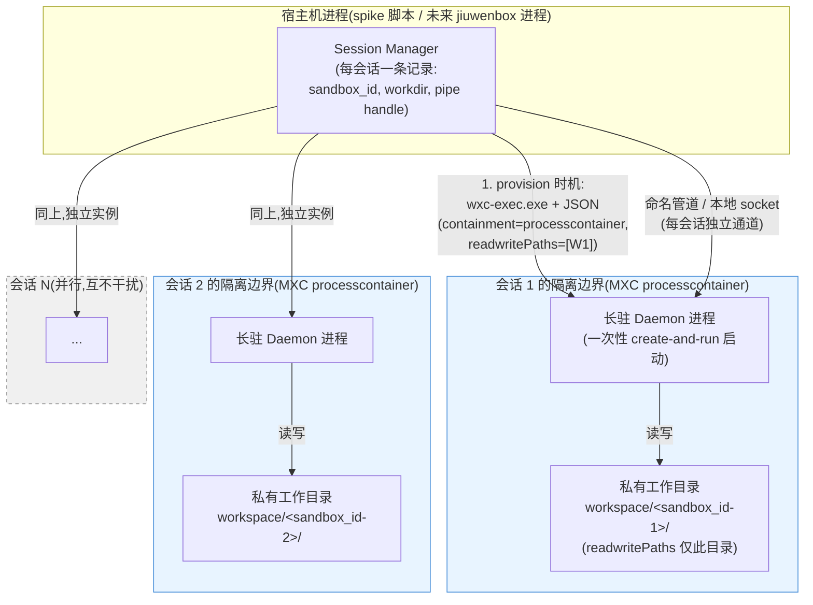
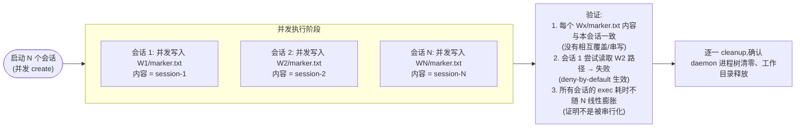
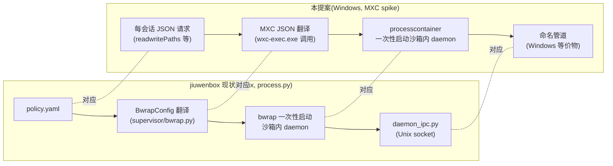

# MXC per-session 隔离——架构图与流程图

> 配套 [design.md](design.md)。本图对应 §6 阶段 1(验证 spike)选定的架构:
> 由于 `processcontainer`/`bubblewrap`/`seatbelt` 都是一次性执行
> (`ScriptRunner`),没有"创建容器、exec 多次、销毁容器"的原生生命周期,
> 所以会话内复用通过"在一次性沙箱里启动一个长驻 daemon,后续 exec 走 IPC"
> 实现——这正是 jiuwenbox 现有 `process.py` 对 bubblewrap 采用的同一套策略,
> 只是把"生成 bwrap argv"换成"生成 MXC JSON 请求"。

## 1. 整体架构



**隔离边界来源于两层,不是一层:**

1. **MXC 策略层**(每个会话独立声明):`readwritePaths` 只包含该会话自己的
   工作目录,`readonlyPaths` 只给系统基线,其余路径对该会话的 daemon
   不可见(Windows `processcontainer` 的 deny-by-default + ACL 叠加,见
   design.md §2)。
2. **进程边界层**:每个会话的 daemon 是独立的 OS 进程,通过独立的
   命名管道通信,互相之间没有共享句柄、没有共享内存、没有共享 cwd。

两层叠加,会话之间既看不见对方的文件,也没有进程级的交叉访问路径——
这是"并行运行且互不干扰"的落地依据,不是假设。

## 2. 单会话生命周期(create → exec×N → cleanup)

```mermaid
sequenceDiagram
    participant SM as Session Manager
    participant MXC as wxc-exec.exe<br/>(一次性 create-and-run)
    participant D as Daemon 进程<br/>(在 processcontainer 沙箱内)
    participant W as 私有工作目录

    SM->>SM: 1. 分配 sandbox_id,创建私有工作目录 W
    SM->>MXC: 2. create():构造 JSON 请求<br/>containment=processcontainer<br/>readwritePaths=[W]<br/>process.commandLine=启动 daemon 脚本
    activate MXC
    MXC->>D: 3. 在沙箱内 fork/exec daemon
    deactivate MXC
    D->>D: 4. daemon 监听本会话专属命名管道
    Note over SM,D: create() 返回后,MXC 的一次性执行调用已退出;<br/>daemon 作为沙箱内长驻子进程继续运行

    loop 会话期间任意次数
        SM->>D: 5. exec(): 通过命名管道发送 {command, workdir, env}
        D->>W: 执行命令,读写限定在 W 内
        D->>SM: 返回 {exit_code, stdout, stderr}
    end

    SM->>D: 6. cleanup(): 通过管道发送 shutdown,或直接终止 daemon 进程树
    SM->>W: 7. 删除私有工作目录
```

**关键点**:第 2-3 步是 MXC 唯一参与的一次性调用——它只负责"在隔离边界内
启动 daemon"这一下。第 5 步的重复 `exec` 完全绕开 MXC,直接和沙箱内已经
在跑的 daemon 通信,这样就不需要为每次工具调用重新走一次 MXC 的
create-and-run(每次都有进程创建/策略校验开销)。

## 3. 并行会话验证(spike 要证明的事)



这三条验证对应设计文档的验收标准原话:"每个 session 应该隔离,并且可以
并行运行、互不干扰"——分别对应**数据隔离**(marker 内容不串)、
**边界隔离**(跨会话路径不可达)、**并发正确性**(非串行执行,清理完整)。

## 4. 与 process.py(bubblewrap)架构的对照



两条路径的**形状完全一致**——"策略翻译 → 一次性启动沙箱内 daemon →
IPC 复用"——只是 Linux 侧用 bwrap + Unix socket,Windows 侧用
processcontainer + 命名管道。这是本提案选择"daemon-in-sandbox"而不是
"每次 exec 都重新走 MXC"的原因:前者让 Windows 路径和现有 Linux 路径
共用同一套上层概念,未来如果要把两者都收进 `RuntimeAdapter`,接口形状
不需要重新设计。

> 实现上,命名管道换成了更简单的**共享工作目录文件轮询**(daemon 轮询
> `cmd-*.json`,写 `result-*.json`),不是真的 Windows 命名管道——这是
> spike 阶段为避开额外 IPC 复杂度的简化,不影响本图的隔离边界论证(见
> 下方 §5 实测结果)。代码见 [spike/session_daemon.py](spike/session_daemon.py)
> 和 [spike/mxc_session_spike.py](spike/mxc_session_spike.py)。

## 5. 实测结果(2026-11-20,本机 Windows 10.0.26200,MXC `wxc-exec.exe` release 构建)

```
=== Phase A: one-shot parallel isolation across 3 sessions ===
  session 1: exit=0 marker='session-1' expected='session-1' -> PASS
  session 0: exit=0 marker='session-0' expected='session-0' -> PASS
  session 2: exit=0 marker='session-2' expected='session-2' -> PASS
  session 0 reading session 1's marker: exit=1 -> PASS (denied as expected)

=== Phase B: daemon-in-sandbox reuse, 3 sessions x 3 calls, concurrent ===
  all 3 sessions created (daemon.ready observed in each workspace)
  s0/s1/s2 call 0..2: all exit=0, stdout matches expected session-tagged value
  wall time: 2.44s (serial bound for n=3 would be ~4.50s) -> PASS (ran concurrently)
  all sessions cleaned up

=== Summary ===
Phase A (one-shot isolation):       PASS
Phase B (daemon reuse + parallel):   PASS
```

三条验收标准全部通过:**数据隔离**(各会话 marker 内容不串)、
**边界隔离**(跨会话路径读取被拒绝,`exit=1`)、**并发正确性**(3 个会话
的 9 次 exec 总耗时 2.44s,远低于串行化理论值 4.50s,且全部 daemon 清理
干净)。完整实施记录见
[F_20261120_1107_mxc-process-isolation-spike.md](../../../../features/F_20261120_1107_mxc-process-isolation-spike.md)。
