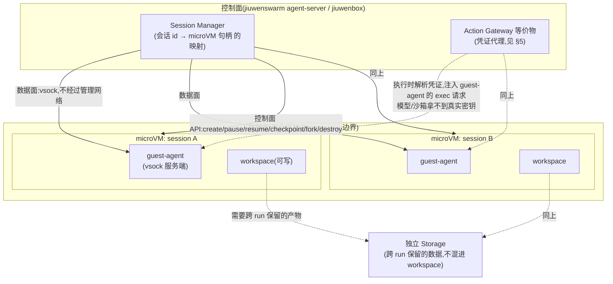

# 用 Firecracker 实现 per-session microVM——对标 DigitalOcean Managed Agents

## 0. 目标:复刻的是什么

目标架构直接参照两份已读过的一手资料,不是转述印象:

- <https://www.digitalocean.com/products/managed-agents>
- <https://docs.digitalocean.com/products/managed-agents/agent-harness-runtime/concepts/architecture/>

DigitalOcean Managed Agents(Harness Runtime)的关键特征,摘自其架构文档:

- 每个会话(session)拿到自己独立的 Firecracker microVM:独立 compute、独立
  文件系统,隔离由**hypervisor 强制**,不是容器 namespace。
- 会话生命周期不是单纯"建→用→销":支持 **pause**(保留完整机器状态、
  停止计费)、**resume**、**checkpoint**(存档)、**fork**(从存档点派生
  独立副本)、**rollback**。这正是 Firecracker 自己的 snapshot/restore
  API 的直接产品化。
- 控制面(会话创建、输入、计费)与数据面(事件流)分离,数据面"从不经过
  特权管理网络"。
- 凭证由独立的 **Action Gateway** 在执行时解析并注入,模型/prompt/沙箱本身
  永远拿不到真实密钥。
- Agent 以标准 **OCI 容器镜像**打包,转换成可复用模板,而不是每次都临时
  拼装运行环境。
- 工作区(workspace)是会话期间的可写目录;需要跨 run 保留的数据走独立的
  Storage,不混在 workspace 里。

本提案的目标:把这套形态在 jiuwenbox 的 `RuntimeAdapter` 抽象上实现一个
Firecracker 后端,会话级 microVM 隔离,具备对等的生命周期操作,而不是
"能起一个 VM 跑命令"这种最小子集。

## 1. 验证基础:本机已实测 Firecracker 可在 Docker(WSL2 + KVM)中跑起来

这不是假设,是刚做完的实测(2026-11-23,本机 Windows + Docker Desktop,
WSL2 backend,内核 `6.6.87.2-microsoft-standard-WSL2`):

1. `docker run --device=/dev/kvm ubuntu:22.04` 内部确认 `/dev/kvm` 可见
   (此前一度认为 WSL2 不暴露 `/dev/kvm`,这个认知已经过时,Microsoft 近期
   版本已经支持)。
2. 容器内下载 Firecracker v1.18.0 官方二进制、CI 测试用的
   `vmlinux-6.18.62` 内核与 Ubuntu 24.04 rootfs(squashfs 转 ext4)。
3. 走真实 API(`/boot-source`、`/drives/rootfs`、`/actions` 之
   `InstanceStart`),microVM **完整启动**:systemd 跑到
   `multi-user.target`,自动登录,落到真实的
   `root@ubuntu-fc-uvm:~#` shell。
4. 核实不是软件模拟:正在跑的 Firecracker 进程的
   `/proc/<pid>/fd` 里能看到 `/dev/kvm`、`anon_inode:kvm-vm`、
   `anon_inode:kvm-vcpu:0` 三个句柄同时打开——这是内核 KVM API 真正在用
   才会出现的对象,不是伪造的。

**这证明的范围**:Windows 开发机上,"Docker 容器 + Firecracker + 真实
KVM"这条链路本身是通的,可以作为本地开发/调试回路使用。**这不等于**生产
部署形态——生产仍然需要真实 Linux 主机(裸金属或支持嵌套虚拟化的云实例),
见 §7。两者不矛盾,是"本地能跑起来验证逻辑"和"生产在哪跑"两个独立问题。

## 2. 架构总览



与 DO 架构的对应关系逐条列出,避免"看起来像"但细节对不上:

| DO 概念 | 本提案对应 |
|---|---|
| Harness Runtime | jiuwenswarm agent-server + jiuwenbox 新增的 `FirecrackerRuntime` |
| 控制面/数据面分离 | 控制面走 Firecracker 自己的 HTTP API(Unix socket,仅本机);数据面走 vsock,不经过任何管理网络 |
| pause/resume/checkpoint/fork/rollback | 直接映射 Firecracker 的 snapshot/restore API(§3) |
| Action Gateway | jiuwenbox 已有的"Inference Privacy Proxy"同构扩展,或新增一个独立凭证代理组件(§5) |
| Agent 打包为 OCI 镜像 | OCI 镜像 → rootfs 转换流水线(§6),复用本提案 §1 已验证的 squashfs→ext4 转换步骤 |
| Workspace vs Storage | workspace 是 microVM 内的可写盘(ext4 drive);Storage 是会话外部的持久化存储,显式 `checkpoint`/上传才落地,不是默认行为 |

## 3. 会话生命周期:映射到 Firecracker 的 snapshot/restore API

Firecracker 自己的能力(非 DO 独有,是 Firecracker 本身的 API 面):

| 操作 | Firecracker API | 延迟量级(Firecracker 自己文档给出的数字) |
|---|---|---|
| create(冷启动) | `PUT /boot-source` + `/drives/*` + `/actions:InstanceStart` | < 125ms |
| pause | `PATCH /vm` `{"state": "Paused"}` | 近乎瞬时(停止 vcpu 执行) |
| checkpoint(存档) | `PUT /snapshot/create` | 3-8.5ms(取决于内存大小) |
| resume / 从存档恢复 | `PUT /snapshot/load` | 3-8.5ms |
| fork(从同一存档起多个独立副本) | 对同一份 snapshot 文件重复 `/snapshot/load`,各自落地到独立的内存/磁盘差异层 | 与 resume 同量级 |
| destroy | 直接终止 Firecracker 进程 + 清理 TAP/cgroup/jailer chroot | 进程级 |

**关键设计决策**:会话的"挂起"默认用 **pause**,不是 destroy——这正是
DO 文档里"idle sessions auto-pause"说的那件事。只有显式删除会话,或闲置
超过更长的淘汰阈值,才真正 destroy 并释放资源。`checkpoint`/`fork` 是
更高阶的能力(团队协作、从某个状态分支出新会话),本提案第一阶段先做
create/pause/resume/destroy,checkpoint/fork 列为阶段 2(§8)。

## 4. Guest-agent 协议(vsock)

Firecracker 本身**没有**内置的"在 guest 里执行命令/传文件"的 API——这是
Firecracker 自己文档明确承认的限制,必须自己实现一个 guest-agent,通过
`virtio-vsock` 和宿主通信。协议设计直接对齐 jiuwenbox 的 `RuntimeAdapter`
抽象方法,保持与现有 `ProcessRuntime`(bwrap)、`MxcRuntime`(Windows,见
`manage` 分支的 D-20261120-1025 提案,未并入本分支)同构:

```
Host (jiuwenbox FirecrackerRuntime)       Guest (vsock 服务端, systemd 单元常驻)
      │  AF_VSOCK connect(cid, port=1024)         │
      ├───────────────────────────────────────────>│
      │  {"op": "exec", "command": [...], "workdir": ..., "env": {...}, "timeout": ...}
      ├───────────────────────────────────────────>│
      │  {"stdout": ..., "stderr": ..., "exit_code": ...}
      │<───────────────────────────────────────────┤
```

- 传输:`AF_VSOCK`,host 侧用 Firecracker 启动时分配的 CID 连接,guest 侧
  是一个随 rootfs 打包好、systemd 托管的小型常驻进程(不是每次 exec 都
  重新起,这一点和 Windows MXC 方案里"daemon-in-sandbox"的理由一致:
  避免每次工具调用都承担一次冷启动代价)。
- 消息格式:换行分隔 JSON,大文件走专门的 `write_file`/`read_file` op,
  base64 或分块传输,不复用 `exec` 的 stdin/stdout。
- 操作集合与 `RuntimeAdapter` 的抽象方法一一对应:`exec`、
  `exec_background`、`get_background_job`、`list_background_jobs`、
  `kill_background_job`、`write_file`、`read_file`、`list_dir`、
  `search_files`。`create`/`pause`/`resume`/`checkpoint`/`fork`/
  `destroy` 是宿主侧对 Firecracker API 的直接调用,不经过这条 vsock
  通道——它们管理的是 VM 本身的生命周期,不是 VM 内部某次操作。
- 健康检查:guest-agent 启动后立即响应固定 `"ping"` op,host 侧用它判断
  "microVM 已经起来、guest-agent 已经就位",而不是猜测启动完成的时间点。

## 5. 凭证代理(Action Gateway 等价物)

DO 的描述:"Credentials are resolved at execution time and are kept away
from the model, the agent prompt, and the sandbox." 这是一个独立于
VM 边界之外的安全层,不能靠"microVM 隔离"本身替代。

jiuwenbox 已经有一个结构相似的组件——**Inference Privacy Proxy**
(`server/proxy_manager`):按 path prefix 路由到不同的 LLM 供应商,转发时
注入真实 API key,客户端(sandbox 内)只拿到一个占位 key。这个模式可以
直接推广到"任意需要凭证的外部服务",不只是 LLM 调用:

- 凭证代理作为一个**独立进程**(不在任何 microVM 里,也不在控制面主进程
  里),持有真实凭证。
- guest-agent 发起的、需要凭证的请求(调 LLM、调外部 API)通过网络策略
  被强制路由到这个代理(等价于 §1 之前 jiuwenbox 在 Linux bwrap 路径下
  已经做的"isolated 网络模式 + egress 规则"那一套,只是落到 microVM 的
  TAP 网络接口上)。
- guest-agent 和 VM 内运行的 agent 代码本身永远看不到真实密钥——这是
  "凭证代理"和"网络隔离"叠加才能保证的,任何一层单独都不够。

## 6. Agent 打包:OCI 镜像 → rootfs

DO 的描述:"bring your own agent as a standard OCI container image and
turn it into a reusable template。" 落地方式,直接复用本提案 §1 已经
验证过的转换步骤,只是把起点换成 OCI 镜像而不是 squashfs:

```
OCI 镜像(docker save / 或直接 docker export 一个已起的容器)
  → 展开成目录树(等价于 §1 的 unsquashfs 步骤)
  → mkfs.ext4 -d <目录树> -F <镜像文件>.ext4
  → 作为 Firecracker 的 rootfs drive
```

这条转换路径是**确定性的、本次已经手工走通一遍**的(squashfs 版本),
OCI 镜像版本的差异只在"展开格式"(OCI layer tar 叠加 vs squashfs 直接
解包),核心的"目录树 → ext4"步骤完全一致。模板一旦生成,后续创建会话
只需 `cp`/CoW 克隆这个 ext4 文件,不需要重新走一次转换流水线——这是
"可复用模板"的落地方式。

## 7. 生产化路径:本机验证 vs 真实部署

必须分开说,不能把 §1 的结果当成生产方案:

- **本机验证(§1)的意义**:证明"Firecracker + KVM"这条链路的*逻辑*
  (API、guest 启动、vsock 协议)可以在开发机上完整跑通调试,不需要先
  拿到一台生产用的 Linux 服务器才能开始写代码。
- **生产部署仍然需要真实的、支持 KVM 的 Linux 主机**。此前已经做过的
  云厂商调研(本分支没有保留那份文档,结论复述如下,待确认仍然成立):
  - Tencent Cloud 的常规 CVM 实例不支持嵌套虚拟化,只有企业级"CBM 裸金属"
    产品线有 KVM,价格门槛高(约 ¥2000+/月起)。
  - Azure 的 `Dv3`/`Dsv3`、`Dv4`/`Dsv4` 等**常规**虚拟机规格(非裸金属)
    官方文档明确支持嵌套虚拟化,`Standard_D2_v3` 约 $0.096/小时
    (约 $70/月),比 Tencent 的裸金属门槛低两个数量级。
  - 两者都需要用本提案 §1 同样的方法(`grep vmx /proc/cpuinfo` +
    `ls /dev/kvm`)在**真实拿到的实例上**重新验证,不能用本机 Windows
    的结果替代——不同的云厂商、不同的虚拟化层,结论不能跨机器复用。
- **部署形态的选择**(裸金属 / 支持嵌套虚拟化的云 VM / 自建 Linux
  开发机)是下一步需要用户拍板的决策,本提案不代为假设。

## 8. 分阶段建议

1. **Guest-agent v0 + 单机 spike**:在本机(或一台真实 Linux 主机,优先级
   高于继续用 Windows+Docker 调试)用本提案 §1 已验证的环境,实现 guest-
   agent 的 `exec` 最小子集,手工验证"创建 microVM → 通过 vsock 执行一条
   命令 → 拿到正确输出",不接 jiuwenbox。
2. **`FirecrackerRuntime` 适配器**:实现 `RuntimeAdapter` 接口,
   `create`/`exec`/`cleanup` 对应 Firecracker 的
   InstanceStart/vsock-exec/进程终止,参照本仓已有的 `ProcessRuntime`
   (`jiuwenbox/src/jiuwenbox/server/runtime/process.py`,manage 分支)
   作为"同一抽象、不同后端"的参照实现,不是从零设计接口形状。
3. **凭证代理**:复用/扩展 `server/proxy_manager` 的 Inference Privacy
   Proxy,验证"guest-agent 内的 LLM 调用拿到的是占位 key,真实 key 只
   存在于代理进程"这条链路。
4. **Pause/resume**:接入 Firecracker 的 `PATCH /vm` 和会话闲置淘汰逻辑,
   对齐 DO 的"idle sessions auto-pause"。
5. **Checkpoint/fork**:接入 `/snapshot/create`、`/snapshot/load`,这是
   DO 架构里"看起来简单但实际是 Firecracker 核心卖点"的部分,建议单独
   起一次 benchmark(本次 §1 的方法可以直接复用)量化"从 snapshot 恢复"
   相对"冷启动"的真实耗时差异,不要只信 Firecracker 文档给的数字。
6. **jailer 化**:阶段 1-5 为了调试方便可以先直接跑裸 `firecracker` 二
   进制;生产路径必须经 `jailer`(chroot、cgroup、降权、network
   namespace),这是 Firecracker 自己文档明确要求的,不是可选项。

## 9. 未决问题

- "会话"的粒度是否就是一个会话一个 microVM(会话期间不重建)?如果是,
  microVM 生命周期需要和会话生命周期显式挂钩(会话创建时 create,会话
  结束/超时时 destroy,闲置时 pause),这部分目前在 jiuwenbox 里没有
  现成的"会话"概念,需要上层(agent-server 还是 jiuwenbox 自己)决定
  谁来发起这些调用——这个问题在更早的 Windows/MXC 提案里也出现过,
  两边应该用同一个答案,不要分别决定两次。
- 凭证代理要做成"LLM 专用"(现有 Inference Privacy Proxy 的直接扩展)
  还是"任意外部服务通用"?后者范围更大,需要先列清楚实际会被 agent
  调用的外部服务清单,再决定代理层要支持哪些协议形态。
- checkpoint/fork 产生的存档文件存在哪里、保留多久、按什么粒度计费/
  清理,目前完全没有设计,是本提案里最大的一块空白,优先级低于先把
  create/exec/destroy 走通。
- 生产部署的主机选型(§7)没有定论,需要用户基于实际预算和运维能力
  拍板,不属于本提案能单方面决定的范围。
