# 用户请求 → Firecracker microVM 执行链路

补充 `design.md` 的实现侧流程图，覆盖单 agent（非 team）会话下，从浏览器输入
到 Firecracker guest-agent 执行命令并把结果带回的完整路径。对应本次已验证
可用的路径（`F_20261123_1420_firecracker-runtime-adapter.md`）。

```mermaid
flowchart TD
    U["用户在浏览器输入消息<br/>http://localhost:5173"]
    FE["Web 前端<br/>channels/web/frontend"]
    WS["Gateway WebChannel<br/>ws://localhost:19000/ws"]
    GW["Gateway HTTP<br/>http://localhost:19001"]
    AS["AgentServer<br/>ws://localhost:18092"]
    HARNESS["jiuwenswarm agent harness<br/>决定需要执行工具/shell 命令"]

    DEEP["JiuWenSwarmDeepAdapter<br/>server/runtime/agent_adapter/interface_deep.py<br/>_create_sandbox_sys_operation()"]
    CFG["get_sandbox_endpoint() / get_sandbox_runtime()<br/>common/config.py<br/>读取 ~/.jiuwenswarm/infra/config/config.yaml<br/>sandbox.type=jiuwenbox-firecracker<br/>sandbox.url=http://127.0.0.1:18321"]
    BUILDER["create_sandbox_sysop_card()<br/>server/runtime/agent_adapter/sysop_builder.py<br/>normalized_type=='jiuwenbox-firecracker' 分支<br/>→ extra_params.api_sandbox_runtime='firecracker'<br/>→ sandbox_type 改写为 'jiuwenbox'"]
    CARD["SysOperationCard<br/>SandboxGatewayConfig<br/>isolation.custom_id = project 路径哈希<br/>launcher_config.base_url = jiuwenbox URL"]

    HTTP["openjiuwen SysOperation 发起 HTTP 请求<br/>POST /api/v1/sandboxes<br/>{sandbox_runtime: 'firecracker', policy: {...}}"]

    JBAPP["jiuwenbox FastAPI server<br/>server/routes/sandbox.py"]
    MGR["SandboxManager.create_sandbox()<br/>server/sandbox_manager.py<br/>normalize_sandbox_runtime('firecracker')<br/>→ RUNTIME_FIRECRACKER<br/>_runtime_for(ref) → FirecrackerRuntime()"]

    FCCREATE["FirecrackerRuntime.create()<br/>server/runtime/firecracker.py<br/>1. 拷贝 golden rootfs.ext4 到 per-sandbox workdir<br/>2. spawn firecracker 子进程 (--api-sock)<br/>3. HTTP-over-UDS: /logger /boot-source /drives<br/>   /machine-config /vsock /actions(InstanceStart)<br/>4. 轮询 vsock ping 等待 guest-agent 就绪"]

    VM["Firecracker microVM 启动<br/>systemd → guest-agent.service<br/>监听 vsock port 52"]

    EXEC["Agent 工具调用触发<br/>POST /api/v1/sandboxes/{id}/exec<br/>FirecrackerRuntime.exec()<br/>host 侧 AF_UNIX: CONNECT 52\\n → OK\\n 握手<br/>发送 JSON {op:'exec', command:...}"]

    GUEST["guest-agent.py (VM 内)<br/>docker/firecracker/guest_agent.py<br/>subprocess.run(command, shell=True)<br/>返回 {exit_code, stdout, stderr}"]

    RESP["结果沿原路径返回<br/>jiuwenbox HTTP 响应 → openjiuwen sandbox 客户端<br/>→ agent harness → Gateway → 前端"]
    DISPLAY["浏览器展示工具执行结果"]

    U --> FE --> WS --> GW --> AS --> HARNESS --> DEEP
    DEEP --> CFG --> BUILDER --> CARD --> HTTP
    HTTP --> JBAPP --> MGR --> FCCREATE --> VM
    VM -. 就绪后 .-> EXEC --> GUEST --> RESP --> DISPLAY
```

## 关键节点对照表

| 阶段 | 代码位置 | 说明 |
|---|---|---|
| 读取 sandbox 配置 | `jiuwenswarm/common/config.py::get_sandbox_endpoint/get_sandbox_runtime` | 单 agent 路径，从 `config.yaml::sandbox` 读取，不检查 `sandbox_type` 是否为 `"jiuwenbox"`（team 路径会检查，见下） |
| 构造 SysOperationCard | `jiuwenswarm/server/runtime/agent_adapter/sysop_builder.py::create_sandbox_sysop_card` | `jiuwenbox-firecracker` 分支把 `api_sandbox_runtime` 写进 `extra_params`，并把 `sandbox_type` 改写回通用的 `"jiuwenbox"`（openjiuwen 侧注册的 provider 名） |
| 隔离 key | `sysop_builder.py::_entry_custom_id` / `_sandbox_isolation_custom_id` | 单 agent 默认按 `project_dir` 哈希，不是按 session id——同一项目目录的不同会话可能复用同一个 microVM |
| jiuwenbox 运行时分发 | `jiuwenbox/src/jiuwenbox/server/sandbox_manager.py::_runtime_for` | `RUNTIME_FIRECRACKER` → 惰性构造 `FirecrackerRuntime()` |
| Firecracker 控制面 | `jiuwenbox/src/jiuwenbox/server/runtime/firecracker.py::create/_fc_api` | 手写 HTTP-over-UDS，已修复「等 EOF 卡死」的 bug（改为按 Content-Length 读取） |
| Firecracker 数据面 | `firecracker.py::_vsock_request` | host 侧纯 `AF_UNIX`，`CONNECT <port>\n` → `OK <port>\n` 握手后即为与 guest-agent 的数据通道 |
| guest 侧执行 | `jiuwenbox/docker/firecracker/guest_agent.py` | VM 内监听 vsock port 52，`exec`/`exec_background`/`bg_status` 等 op |

## 当前已知的路径分叉（team 会话）

Team 会话下，走的是另一条路径 `jiuwenswarm/agents/swarm/assembly.py::_build_member_sandbox_specs`：
它对每个 team 成员单独建一个 `entry_<team>_<entry>` 隔离 key（理论上一个成员一个
microVM），但代码里**硬编码检查 `sandbox_type == "jiuwenbox"`**——只要配置的是
`jiuwenbox-conch` 或 `jiuwenbox-firecracker`，所有成员都会退回 LOCAL（不走沙箱，
直接在宿主机跑），只打一条 warning 日志。也就是说：

- 单 agent 会话：已验证能正确走到 Firecracker microVM。
- Team/子 agent 会话：目前会被 `assembly.py` 的类型检查挡在门外，退回本机执行，
  不会创建 microVM。

这是 jiuwenswarm 既有的限制（Conch 也受影响，不是本次新增），不在本次实现范围内。
