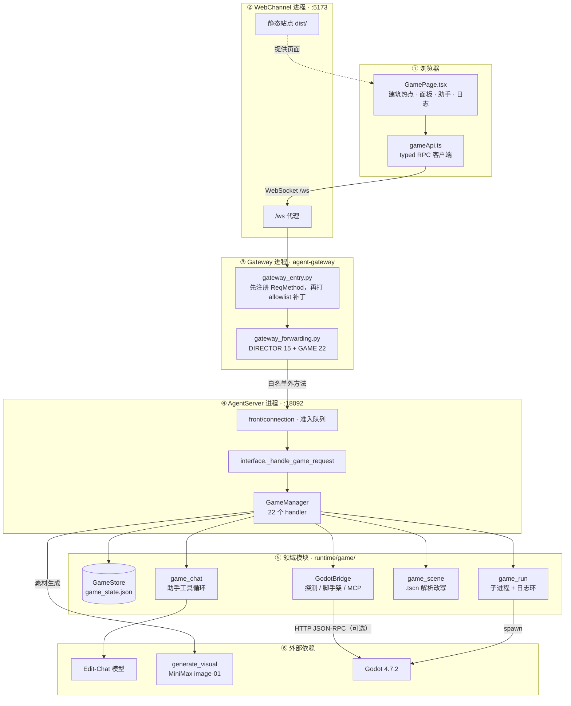
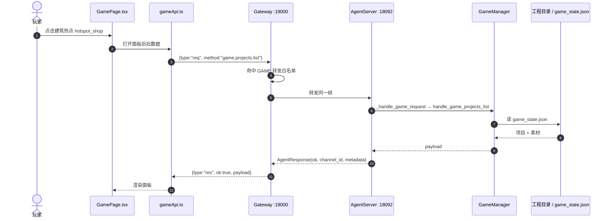
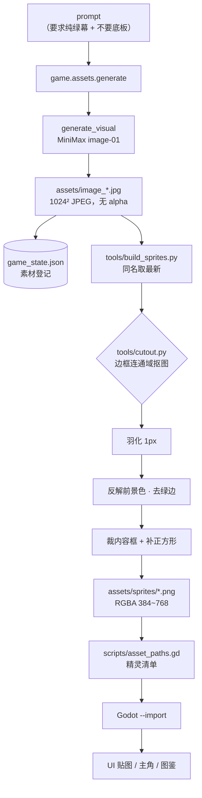

# 游戏模式（游戏工坊）落地后的架构与链路

记录 P0–P2 实际落地后的系统架构，以及「用 JiuwenSwarm 造一个游戏」的真实链路。
设计目标与取舍见 `D-20261107-1637-game-mode`；本文只写**实现事实**与踩过的坑。

产物侧（一个可运行的 Godot 工程，含设计、素材流水线、三套测试）随项目保存在
`<data root>/agent/game/projects/<project_id>/`，其自带文档为
`docs/design.md`（玩法）与 `docs/architecture.md`（同一套图 + 更细的落地说明）。

## 1. 系统架构

浏览器只认 `game.*` 一套 RPC；所有对 Godot 工程的写入都收敛在 `GameManager` 之后，
以便统一做变更集、回退与运行日志。

**网关补丁是必需项**：上游把网关拆成独立 `agent_gateway` 包后，
`_FORWARD_REQ_METHODS` / `_FORWARD_NO_LOCAL_HANDLER_METHODS` 是包内写死的 `frozenset`，
仓库侧没有公开 API 可注册。`gateway_entry.py` 因此按顺序做两件事，再调用
`agent_gateway.app_gateway.main()`：

1. `import jiuwenswarm.common.schema.message` —— 让 `GAME_*` 的 `ReqMethod` 成员在网关进程里存在；
2. 把 `DIRECTOR_FORWARD_METHODS | GAME_FORWARD_METHODS` 并进上述两个集合。

少第 1 步，网关在方法枚举处直接返回 `unknown method`；少第 2 步，请求到不了 AgentServer。

## 2. 一次点击的链路

22 个 `game.*` 方法同构，以 `game.projects.list` 为例：

第 10 步曾长期 500：`AgentResponse` 改为从协议包导入后只接受 `channel_id` / `metadata`，
游戏分支仍在传 `req_method`，于是每个 `game.*` 都在 AgentServer 侧炸成
`unexpected keyword argument 'req_method'`，前端表现为空白工作区。

## 3. 素材流水线（含素材落盘与抠图）

模型出的是 JPEG，没有 alpha；「透明背景」必须自己抠。prompt 统一要求纯绿幕，
再由随工程保管的 Python 脚本转换：

实现期确认的三个坑：

| 坑 | 现象 | 处理 |
|---|---|---|
| 底色带渐变 | 单色阈值抠不干净 | 以边框均值为幕布色，只抠**与边框连通**的像素 |
| 模型自作主张画底板 | 图标变成绿色圆角卡片，抠图只剩卡片 | 多采样背景点，让连通填充穿过底板 |
| Pillow 12 `ImageDraw.floodfill` | 1024² 蒙版上静默返回，`keyed=0.000` | 换自写扫描线填充 |

## 4. 代码改动与回退

助手只拿五个文件级工具（`list_files` / `read_file` / `write_file` / `generate_asset` /
`build_2d`），变更集来自**文件快照前后对比**，因此模型绕不过审计，也天然可回退：

`game.chat.send` → 工具循环（上限 6 轮）→ 快照 diff → `change_set` → 前端预览 →
不满意则 `game.changes.revert` 按 `change_set` 写回。

实测偏差：一次要求「重写三个文件」会撞上 6 轮上限，需人工用 `game.files.write` 接续。

## 5. 验证闭环

正确性证据全部来自 Godot 自身的执行，不是 Python mock：

| 层 | 入口 | 断言数 | 验证内容 |
|---|---|---|---|
| 规则 | `tests/selftest.gd`（`--script`） | 85 | 体力恢复/倒退、三区域掉落记账、宠物收录与升级、驻守结算与等级加成、商店六项、存档往返与 v1 迁移 |
| 场景 | `tests/scene_smoke.tscn` | 9 | 资源条渲染、建筑热点存在、跳跃上移并精确回位 |
| 交互 | `tests/ui_flow.tscn` | 33 | 驱动真实按钮回调走完四系统、面板开关、`save.json` 结构 |
| 真机 | `game.run.start` → `game.run.logs` | — | 窗口模式启动 Godot，日志出现 `[game] 主城就绪` |
| 观感 | `--capture` → `user://capture*.png` | — | 逐页截图做视觉验收 |

## 6. 与设计文档的偏差

| 设计预期 | 实际落地 |
|---|---|
| 场景/属性编辑走 Godot-MCP（RQL） | 本机缺 .NET 8 SDK 与 mono 构建，C# 插件编不了；改为直接解析/改写 `.tscn`，MCP 走 `GODOT_MCP_URL` 的 HTTP JSON-RPC 通道预留 |
| 3D 脚手架 | 只做 2D 主城，`GameBridge.scaffold` 保留 3D 入口未启用 |
| 导出 Web/Windows（P3） | 未做，缺 Godot export templates |
| 代码工作区只读 `.gd/.tscn` 等 | 追加 `.py`，否则工程自带素材流水线在代码页不可见 |

## 7. 运行态数据落点

| 内容 | 路径 |
|---|---|
| 项目 / 素材登记 | `<data root>/agent/game/game_state.json` |
| Godot 工程 | `<data root>/agent/game/projects/<project_id>/` |
| 玩家存档 | Godot user dir（按项目名）下的 `save.json` |
| 运行截图 | Godot user dir 下的 `capture*.png` |
| 网关补丁日志 | `agent/.logs/director-forwarding.log` |
