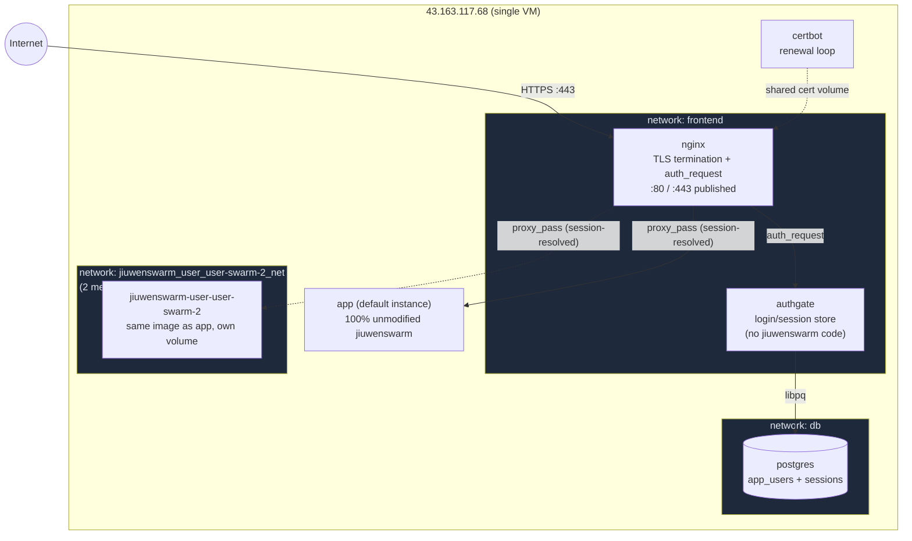
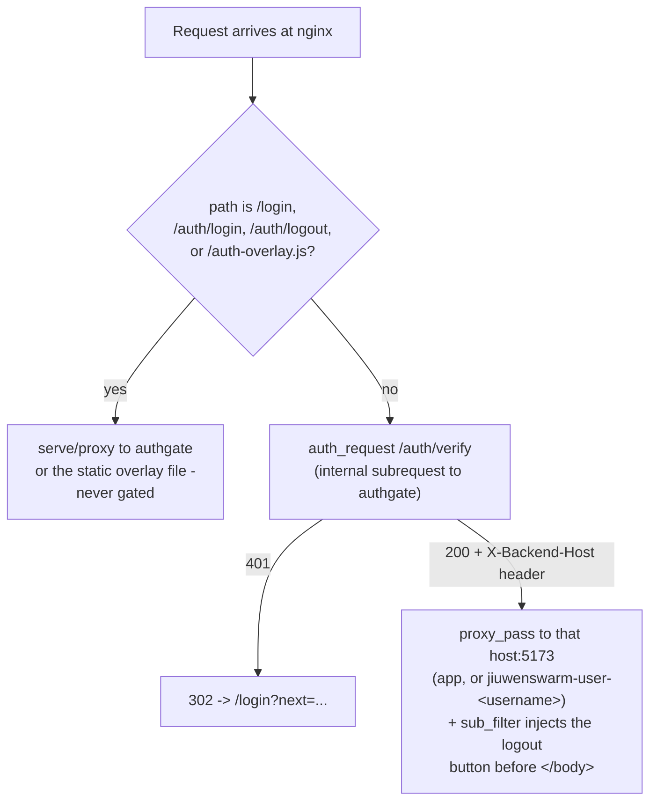

# Deployment architecture: zero-merge login gate + per-user isolation

This documents the production deployment at `https://workswarm.app`:
`docker-compose.yml`, the nginx `auth_request` login gate backed by
`deploy/authgate/`, and per-user environment isolation
(`deploy/provision_user.sh`). It exists so the reasoning behind the design
doesn't live only in commit messages.

## 0. Why this design: zero merges on every upstream release

`openJiuwen-ai/jiuwenswarm:develop` keeps moving. An earlier version of this
deployment embedded the login gate directly inside the app
(`jiuwenswarm/channels/web/app_web.py`, `simple_auth.py`, a logout button in
`SessionSidebar/index.tsx`). That worked, but every time upstream touched
those same files - which `app_web.py` especially does constantly - updating
meant re-resolving a merge conflict by hand.

This design moves the entire auth layer **outside** the jiuwenswarm repo:

- `app` and every `jiuwenswarm-user-<username>` container are a **completely
  unmodified** jiuwenswarm instance - no auth code, no Postgres access, not
  even aware this deployment has a login page.
- `deploy/authgate/` is a small, independent Python service (not part of the
  jiuwenswarm package) that owns the `app_users`/`sessions` tables and
  answers exactly one question nginx asks on every request: *is this session
  valid, and which backend does it route to?*
- The logout button is injected into the page by nginx itself
  (`sub_filter`, see §4) from a static JS file this deployment owns -
  `jiuwenswarm/channels/web/frontend` never needed a logout feature added to
  it.
- `docker-compose.yml`, `deploy/*`, `.env.example` are all **new, additive**
  files/directories that don't exist in the upstream repo at all - no
  existing upstream-tracked file is touched by this deployment anywhere.

The result: picking up a new jiuwenswarm release is `git fetch upstream &&
git merge --ff-only upstream/develop` (or, on this `source` branch, just
reset to the new upstream tip) followed by `docker compose build app`. There
is nothing to merge, because nothing upstream was ever changed.

## 1. System overview

One public domain, one login page, but every user that needs real isolation
gets their own complete, independent backend - own Director assets, own
chat history, own `config.yaml`/`.env` (model API keys), own MCP connector
credentials. Nothing is shared between users except the login page and the
one Postgres table (owned by `authgate`, not by any jiuwenswarm instance)
that says who's allowed in and which backend they land on.



**Key fact that makes this cheap**: every bit of per-user state - Director
assets, chat/session history, `config.yaml`/`.env`, MCP credential store -
resolves from one root (`get_user_workspace_dir()` in
`jiuwenswarm/common/utils.py`), and that root is just "wherever this
process's own filesystem happens to be." Two separate Docker containers each
have their own `/home/app/.jiuwenswarm` volume, so two separate containers
are automatically two separate, fully isolated workspaces - **zero
application code needed to enforce the isolation itself**, only to route each
session to the right container (and now, routing lives in nginx, not in the
app either).

## 2. Network segmentation

| Network | Members | Why |
|---|---|---|
| `frontend` | `nginx`, `app`, `authgate`, `certbot` | nginx reaches `app` and `authgate`. `app` cannot reach `authgate` or Postgres - it has no reason to, it has no auth code. |
| `db` | `authgate`, `postgres` | Only `authgate` talks to Postgres. nginx, `app`, and every user backend are not on this network at all. |
| `jiuwenswarm_user_<username>_net` (one per user) | `nginx`, exactly that one `jiuwenswarm-user-<username>` | Created by `deploy/provision_user.sh` at provisioning time. Each has exactly two members, so one user's backend can never reach another's, and nothing but nginx can reach any of them. |

**Why nginx, not `app`, joins the per-user networks**: in the embedded
design, `app` did the per-user reverse-proxy hop itself (it had to, since it
was also the thing checking the session). Now that auth is a yes/no + "which
host" answer from `authgate`, nginx can act on that answer directly via a
variable `proxy_pass` - there is no reason to add a hop through `app` just to
reach a sibling container. This also means `app` needs *no* elevated network
reach at all: it only ever sits on `frontend`, reachable solely by nginx.

**Operational cost** (unchanged in kind from before, just nginx instead of
`app`): nginx's per-user network memberships are established imperatively
(`docker network connect`, see §5) and are **not** tracked by
`docker-compose.yml`. Any future recreate of the `nginx` container (e.g.
`docker compose up -d --build nginx`) only restores `frontend`; every
per-user connection is lost until `deploy/reconnect_user_networks.sh` runs.

## 3. Request routing (every request, after TLS termination)



The routing decision happens entirely in nginx (`deploy/nginx/app-ssl.conf`):
`auth_request_set $backend_host $upstream_http_x_backend_host;` captures the
header `authgate`'s `/verify` endpoint returns, and `proxy_pass
http://$backend_host:5173;` sends the request there. One `resolver`
directive (Docker's embedded DNS, `127.0.0.11`) is required for nginx to
resolve that variable host at request time.

## 4. The injected logout button

`jiuwenswarm/channels/web/frontend` has no logout feature and needs none.
nginx rewrites every response body passing through the gated `location /`
block:

```nginx
proxy_set_header Accept-Encoding "";   # sub_filter can't rewrite gzip
sub_filter '</body>' '<script src="/auth-overlay.js"></script></body>';
sub_filter_once on;
```

`/auth-overlay.js` (`deploy/nginx/static/auth-overlay.js`) is served
directly by nginx, not proxied anywhere. It draws a small fixed-position
button and calls `POST /auth/logout` on click. Since nginx already gated the
page the script arrived on, no further "am I logged in" check is needed
before showing it.

## 5. Login flow

```mermaid
sequenceDiagram
    participant Browser
    participant Nginx as nginx
    participant Auth as authgate
    participant PG as postgres

    Browser->>Nginx: POST /auth/login {username, password}
    Nginx->>Auth: proxy_pass (unchanged)
    Auth->>PG: SELECT password_hash, backend_base_url<br/>WHERE username = ?
    PG-->>Auth: row
    Auth->>Auth: bcrypt.checkpw(password, hash)
    alt credentials valid
        Auth->>PG: INSERT INTO sessions (token, username, backend_base_url, expires_at)
        Auth-->>Nginx: 200 + Set-Cookie jiuwen_session=<token>
        Nginx-->>Browser: 200 + Set-Cookie (HttpOnly; Secure; SameSite=Lax)
    else invalid
        Auth-->>Browser: 401
    end
    Note over Auth,PG: Sessions live in Postgres, not in-process memory -<br/>authgate can restart (or run >1 replica) without<br/>logging everyone out.
```

## 6. Provisioning a new isolated user

`deploy/provision_user.sh <username> <password>`, run on the host (not
inside any container - deliberately: giving a public-facing container
Docker-socket access to create sibling containers would be a much bigger
privilege-escalation surface than keeping container lifecycle management on
the host side):

1. `docker network create jiuwenswarm_user_<username>_net`.
2. `docker network connect jiuwenswarm_user_<username>_net jiuwenswarm-nginx`
   (not `jiuwenswarm-app` - see §2 for why).
3. `docker volume create jiuwenswarm_user_<username>_workspace` - a fresh,
   empty workspace, never copied from anyone else's.
4. `docker run -d --name jiuwenswarm-user-<username> --network
   jiuwenswarm_user_<username>_net ... jiuwenswarm-app` - the exact same
   image as the default `app` service, zero code differences. No Docker
   socket, no `ports:` mapping.
5. `authgate`'s `create_user_cli()` run inside the `authgate` container via
   `docker compose exec`, password passed through an env var (never
   interpolated into the Python source) - inserts the one row that makes
   this user routable.

No model/API-key credentials are set for a newly provisioned user - nothing
of another user's keys is ever copied in. A new user's chat won't work until
credentials are supplied for that account specifically (same as before).

**After any redeploy of nginx**, run `deploy/reconnect_user_networks.sh` (no
arguments) - see §2.

**Removing a user**: `docker rm -f jiuwenswarm-user-<username>`, then
`docker network disconnect jiuwenswarm_user_<username>_net jiuwenswarm-nginx`
(required first) and `docker network rm jiuwenswarm_user_<username>_net`,
then `docker volume rm jiuwenswarm_user_<username>_workspace`, then delete
their `app_users` row via `authgate`. `provision_user.sh` prints these exact
commands at the end of a successful run.

## 7. What's deliberately out of scope today

- **Lazy start/stop of user containers.** Every provisioned user's container
  runs continuously.
- **Per-volume disk quotas.**
- **Hardening the gateway's own handshake auth.** Network segmentation is
  what carries the isolation guarantee today.
- **Tencent Cloud Object Storage.** Deliberately not wired up in this
  deployment.

## 8. File reference map

| File | Role |
|---|---|
| `docker-compose.yml` | `postgres`, `authgate`, `app`, `nginx`, `certbot`, and the `frontend`/`db` network topology (per-user networks are created dynamically, not declared here - see §2). |
| `deploy/authgate/` | The entire login/session/logout gate - `app.py`, `login.html`, its own `Dockerfile`. Pure deploy-side code, never touched by an upstream pull. |
| `deploy/provision_user.sh` | Creates one new isolated user end-to-end (§6). |
| `deploy/reconnect_user_networks.sh` | Re-attaches nginx to every user's network after an nginx redeploy (§2, §6). |
| `deploy/nginx/conf.d/app.conf`, `deploy/nginx/app-ssl.conf` | nginx config: auth gate, dynamic per-session routing, logout-button injection (bootstrap HTTP-only, then swapped to the TLS version post-certbot). |
| `deploy/nginx/static/auth-overlay.js` | The injected logout button (§4). |
| `deploy/init-letsencrypt.sh` | One-time cert bootstrap for the primary domain. |
| `deploy/update.md` | Step-by-step procedure for pulling a new upstream release (§0). |
