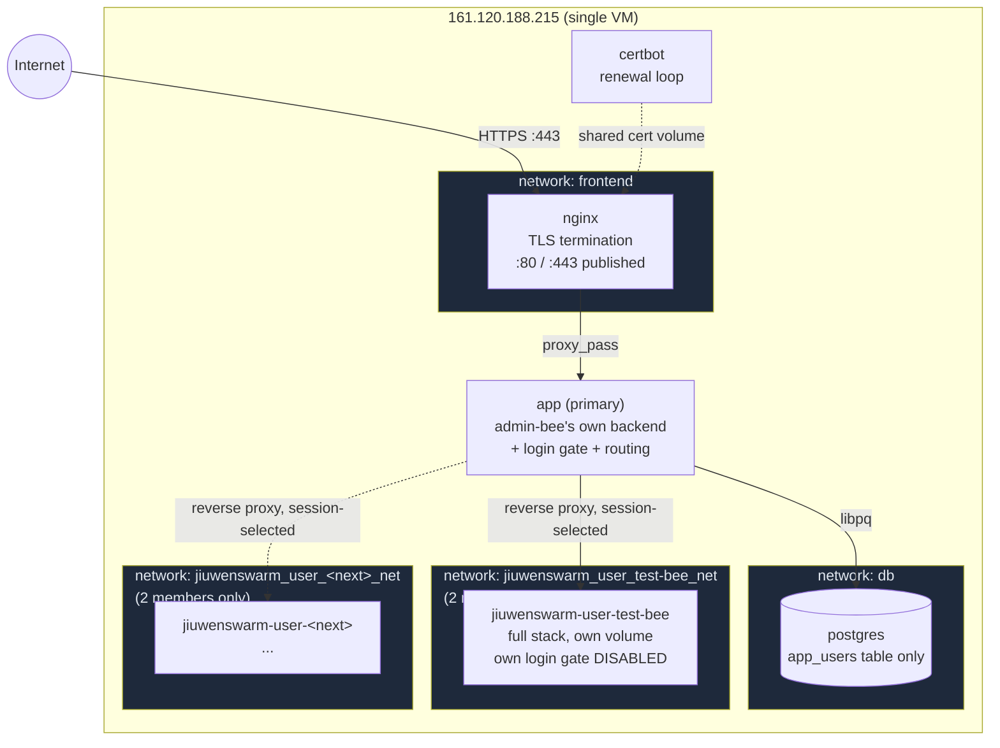
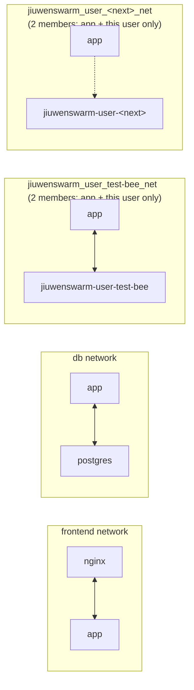
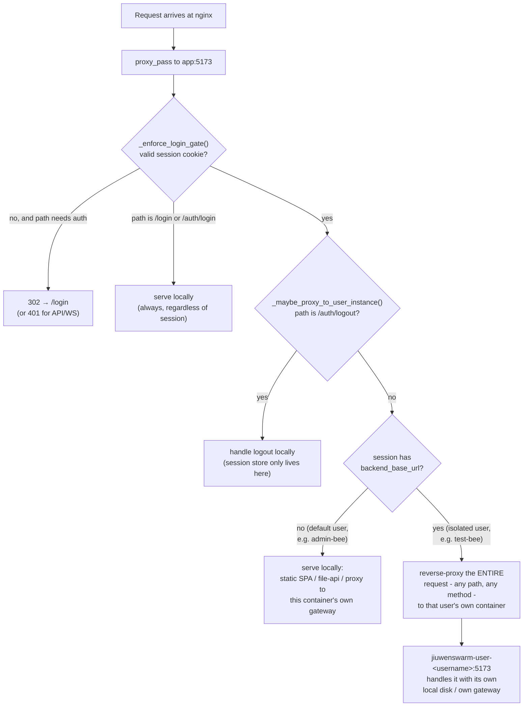

# Deployment architecture: login gate + per-user isolation

This documents the production deployment at `https://happypeaceland.net`:
`docker-compose.yml`, the Postgres-backed login gate (`jiuwenswarm/channels/web/simple_auth.py`),
and per-user environment isolation (`deploy/provision_user.sh`). It exists so the
reasoning behind the design doesn't live only in commit messages.

## 1. System overview

One public domain, one login page, but every user that needs real isolation
(not just the default account) gets their own complete, independent backend -
own Director assets, own chat history, own `config.yaml`/`.env` (model API
keys), own MCP connector credentials. Nothing is shared between users except
the login page itself and the one Postgres table that says who's allowed in
and which backend they land on.



**Key fact that makes this cheap**: every bit of per-user state - Director
assets, chat/session history, `config.yaml`/`.env`, MCP credential store -
resolves from one root (`get_user_workspace_dir()` in
`jiuwenswarm/common/utils.py`), and that root is just "wherever this
process's own filesystem happens to be." Two separate Docker containers each
have their own `/home/app/.jiuwenswarm` volume, so two separate containers
are automatically two separate, fully isolated workspaces - **zero
application code needed to enforce the isolation itself**, only to route each
session to the right container.

## 2. Network segmentation

Every service sits on exactly the networks it needs and no others. The
primary `app` container is the only thing that bridges multiple segments -
and critically, Docker doesn't forward traffic *between* two networks just
because one container has an interface on both, so `app` being attached to
everything doesn't let traffic flow between, say, two users' networks.



| Network | Members | Why |
|---|---|---|
| `frontend` | `nginx`, `app`, `certbot` | nginx only ever needs to reach the primary `app`. It can never reach `postgres` or any user's backend, even if compromised. |
| `db` | `app`, `postgres` | Only the primary app's login gate talks to Postgres. Nginx and user backends are not on this network at all. |
| `jiuwenswarm_user_<username>_net` (one per user) | `app`, exactly that one `jiuwenswarm-user-<username>` | Created by `deploy/provision_user.sh` at provisioning time. Each has exactly two members, so one user's backend can never reach another's - not just application-level isolation, they're not even on the same network. |

**Threats this closes**:
1. A remote vulnerability in `nginx` or the primary `app` (reached over the
   network, *not* SSH/host access - that's a different, higher privilege
   boundary covered by the SSH key, not Docker networking) used to be able to
   pivot straight to any user's backend with zero login, because per-user
   backends intentionally run with their own login gate disabled (`PGHOST`
   unset - they trust that the only path in is through the primary's
   already-authenticated proxy). `nginx` and `postgres` simply cannot resolve
   or route to a `jiuwenswarm-user-*` hostname at all.
2. One user's backend being compromised (in principle - its own login gate
   is disabled by design, so if anything *did* get past the network boundary
   it would have free rein) can no longer reach a sibling user's backend
   either. Each per-user network has exactly two members: `app` and that one
   user. Verified directly: `jiuwenswarm-user-test-bee` cannot even resolve
   `jiuwenswarm-user-<other>` by hostname.

**The operational cost of this**: `app`'s per-user network memberships are
established imperatively (`docker network connect`, see §5) and are **not**
tracked by `docker-compose.yml` - a static list there would mean editing the
file and redeploying for every new user, defeating the point. The
consequence: any future recreate of the `app` container (e.g. `docker
compose up -d --build app`) only restores the two networks Compose *does*
know about (`frontend`, `db`); every per-user connection is silently dropped
until `deploy/reconnect_user_networks.sh` is run afterward. This is now a
required step after any `app` redeploy - see §5 and the script's own header.

## 3. Request routing (every request, after TLS termination)



The routing decision (step H) happens in
`_SpaStaticHandler._maybe_proxy_to_user_instance()` in
`jiuwenswarm/channels/web/app_web.py`, called right after the login gate
succeeds in every `do_GET`/`do_POST`/`do_PUT`/.../`do_HEAD`. It reuses the
existing `_proxy_http()` / `_proxy_websocket_tunnel()` methods as-is (they
already forward `self.path` verbatim, no prefix-stripping) by pointing
`self.api_target`/`self.ws_target` at the resolved backend for that one
request - so static assets, `/file-api/*`, `/ws`, and `/api/*` are *all*
covered by one interception point, not reimplemented per route.

`/login`, `/auth/login`, and `/auth/logout` are hard-excluded from step H
regardless of session state: session management only exists on the primary
instance (that's where Postgres and the in-memory session table live), so a
logged-in secondary user's own logout request must never get proxied to
their backend (which has no session store at all).

## 4. Login flow

```mermaid
sequenceDiagram
    participant Browser
    participant App as app (primary)
    participant PG as postgres

    Browser->>App: POST /auth/login {username, password}
    App->>PG: SELECT password_hash, backend_base_url<br/>WHERE username = ?
    PG-->>App: row
    App->>App: bcrypt.checkpw(password, hash)
    alt credentials valid
        App->>App: create_session(username, backend_base_url)<br/>(in-memory, resolved once, cached for session lifetime)
        App-->>Browser: 200 + Set-Cookie jiuwen_session=<token><br/>HttpOnly; Secure; SameSite=Lax
    else invalid
        App-->>Browser: 401
    end
    Note over App: Every later request just looks up<br/>the token in the in-memory session dict -<br/>no Postgres round-trip per request.
```

Sessions never query Postgres again after login - `backend_base_url` is
resolved once and cached in the in-memory session entry
(`simple_auth.get_session()`), the same performance-conscious pattern the
gate already used for `is_authenticated()`.

## 5. Provisioning a new isolated user

`deploy/provision_user.sh <username> <password>`, run on the host (not
inside any container - deliberately: giving the public-facing `app`
container Docker-socket access to create sibling containers would be a much
bigger privilege-escalation surface than keeping container lifecycle
management on the host side):

1. `docker network create jiuwenswarm_user_<username>_net` - a fresh network
   that will end up with exactly two members.
2. `docker network connect jiuwenswarm_user_<username>_net jiuwenswarm-app` -
   attaches the primary `app` container (already running) to it. This works
   on a live container with no restart, which is what keeps the whole script
   a one-command, no-redeploy operation.
3. `docker volume create jiuwenswarm_user_<username>_workspace` - a fresh,
   empty workspace, never copied from anyone else's.
4. `docker run -d --name jiuwenswarm-user-<username> --network
   jiuwenswarm_user_<username>_net ...` - full `jiuwenswarm-start` ("all"
   mode: its own agent_server, gateway, *and* its own `app_web.py`/static/
   file-api layer - needs the full stack because file-api and static serving
   read local disk directly today, not proxied through the gateway). No
   `ports:` mapping, no Docker-socket mount, `PGHOST` left unset (its own
   login gate stays off).
5. `simple_auth.create_user(username, password, backend_base_url=...)` run
   inside the *primary* `app` container, via `docker compose exec` with the
   password passed through an env var (never interpolated into the Python
   source, so shell-special characters in a real password can't be misread
   as shell syntax) - inserts the one row that makes this user routable.

No model/API-key credentials are set for a newly provisioned user - nothing
of another user's keys is ever copied in, so "no access to other users' API
keys" holds by construction, not by a filter that could have a bug. A new
user's chat/Director generation won't work until credentials are supplied
for that account specifically.

**After any redeploy of the primary `app` service**, run
`deploy/reconnect_user_networks.sh` (no arguments). It reads every
provisioned username from `app_users.backend_base_url`, derives each one's
network name, and re-runs `docker network connect` for any that are missing
- idempotent, safe to run anytime, reports what it did either way. This is
the direct consequence of §2's "operational cost" paragraph; skipping it
after a redeploy means every isolated user's routing is silently broken
until it's run.

**Removing a user**: `docker rm -f jiuwenswarm-user-<username>`, then
`docker network disconnect jiuwenswarm_user_<username>_net jiuwenswarm-app`
(required first - Docker refuses to remove a network with active endpoints)
and `docker network rm jiuwenswarm_user_<username>_net`, then `docker volume
rm jiuwenswarm_user_<username>_workspace`, then delete their `app_users` row.
`provision_user.sh` prints these exact commands at the end of a successful run.

## 6. What's deliberately out of scope today

- **Lazy start/stop of user containers.** Every provisioned user's container
  runs continuously. Fine for a handful of users on this box (~1-1.5GB RAM
  each); would need a host-level idle-reaper (not inside the public
  container, for the same privilege reason as §5) if the user count grows
  enough to matter.
- **Per-volume disk quotas.** Docker's default `local` volume driver has no
  size cap - one user's heavy usage could in principle fill the shared disk.
  Not urgent at current usage (tens of MB per user, 70+GB free), worth
  revisiting with filesystem-level quotas if that changes.
- **Hardening the gateway's own handshake auth.** The backend
  (agent_server + gateway) has no authentication of its own -
  `set_handshake_auth` exists in `jiuwenswarm/gateway/channel_manager/base.py`
  but is never wired up anywhere in the repo - so it trusts any caller that
  can reach it over the network. Network segmentation (§2) is what actually
  carries the isolation guarantee today; this hook is a real extension point
  if a second, independent layer of defense is ever wanted.

## 7. File reference map

| File | Role |
|---|---|
| `docker-compose.yml` | Primary stack: `postgres`, `app`, `nginx`, `certbot`, and the `frontend`/`db` network topology (per-user networks are created dynamically, not declared here - see §2). |
| `deploy/provision_user.sh` | Creates one new isolated user end-to-end (§5). |
| `deploy/reconnect_user_networks.sh` | Re-attaches `app` to every user's network after an `app` redeploy (§2, §5). |
| `deploy/nginx/conf.d/app.conf`, `deploy/nginx/app-ssl.conf` | nginx config (bootstrap HTTP-only, then swapped to the TLS version post-certbot). |
| `deploy/init-letsencrypt.sh` | One-time cert bootstrap for the primary domain. |
| `jiuwenswarm/channels/web/simple_auth.py` | `app_users` table, `create_user()`, session creation/lookup, password hashing. |
| `jiuwenswarm/channels/web/app_web.py` | `_enforce_login_gate()` (§4), `_maybe_proxy_to_user_instance()` (§3). |
| `jiuwenswarm/channels/web/simple_auth_login.html` | The login page itself (single static file, no build step, no separate asset route - images are inlined as base64 data URIs). |
