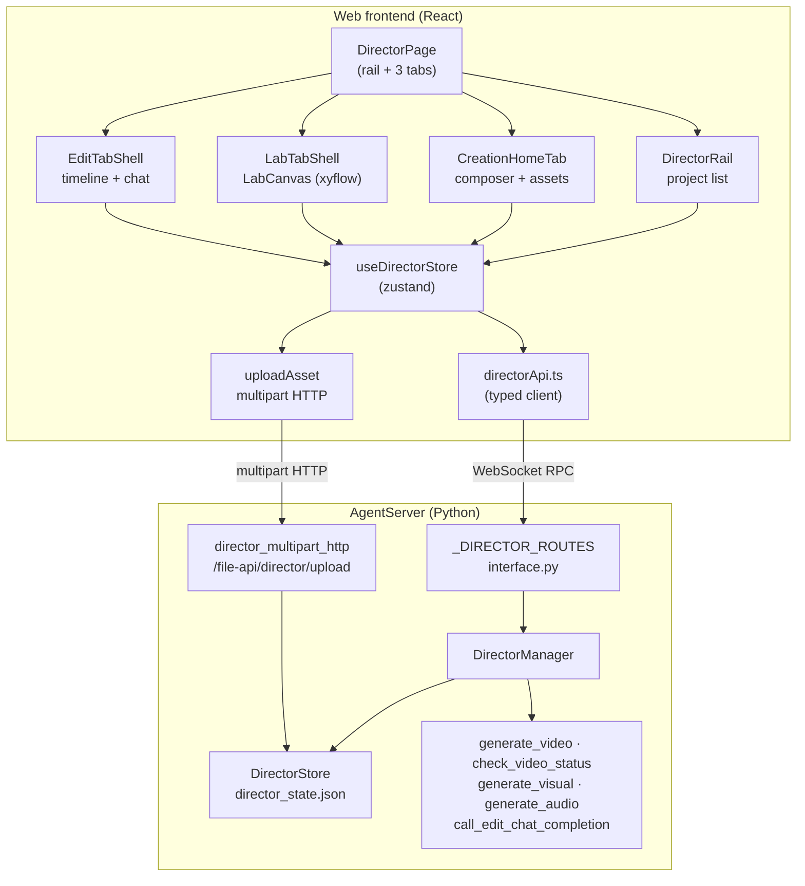
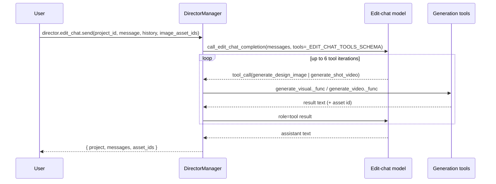

# Director Mode — System Architecture

> Scope: **Director Mode** (导演模式) on branch `videoGenDirector` — the Web
> frontend feature `jiuwenswarm/channels/web/frontend/src/features/director/`
> and its backend counterparts (`director.*` RPC in AgentServer, the
> `jiuwenswarm/server/runtime/director` package, and the `video_gen_tools` /
> `visual_gen_tools` / `audio_gen_tools` / `edit_chat_tools` tool functions).

Director Mode is a **project / asset / canvas** workspace for AI media
production. Unlike Design mode (agentic graph execution), Director Mode calls
generation tools **directly**: the composer form fully determines the tool
arguments, so no LLM turn is inserted between the UI and the generator
(`director_manager.generate_video._func` / `generate_visual._func`).

---

## 1. Layering at a glance



Two transports are used, deliberately:

| Direction | Mechanism | Notes |
|-----------|-----------|-------|
| `director.*` RPC | WebSocket via `webRequest` | All project/asset/generate/edit-chat calls. |
| Asset upload | `POST /file-api/director/upload` (multipart) | A binary body does not fit the JSON RPC envelope; handled by a separate HTTP handler. |
| Status polling | Client-side timer on `director.generate.check_status` | Director Mode has **no server push**; the client polls for long-running video jobs. |

---

## 2. Entry point & navigation

| Item | Value |
|------|-------|
| Nav key | `director` — registered in `components/SessionSidebar/index.tsx` (`nav.director`, "Director" / "导演"). |
| Route | `App.tsx`: `{activeNav === 'director' && <DirectorPage />}` |
| Tabs | `DirectorTabKey = 'create' | 'lab' | 'edit'`, held in `useDirectorStore.activeTab` |

`DirectorPage` renders the project rail plus one tab at a time:

```
DirectorPage
├── DirectorRail            project list, select / new project
├── activeTab === 'create'  → CreationHomeTab    (prompt + params → generate)
├── activeTab === 'lab'     → LabTabShell        (node canvas of process cards)
└── activeTab === 'edit'    → EditTabShell       (timeline + edit chat)
```

`EditTabShell` is remounted on project switch via `key={selectedProject?.project_id ?? 'none'}`
— without it, the per-project timeline state would show the previous project's
data after switching projects while staying on the Edit tab.

Opening a project from the 我的项目 grid (`ProjectGrid`, only used by
`CreationHomeTab`) both selects it **and** switches `activeTab` to `lab`: the create
tab is where you pick or create a project, so staying there after opening one leaves
you looking at the cards instead of the project. The 新建项目 card is deliberately
*not* part of that — it opens `NewProjectDialog` and stays on `create`, so the new
project can be named and confirmed before anything moves.

---

## 3. Frontend module map

### 3.1 State — `directorStore.ts` (zustand, single store)

| Group | Fields |
|-------|--------|
| Navigation | `activeTab` |
| Projects | `projects`, `projectsLoading`, `projectsError`, `selectedProjectId`, `assetCounts` |
| Composer | `composerMode`, `composerPrompt`, `composerParams` |
| Generation | `generating`, `generateError`, `pendingGeneration` |
| Upload | `uploading`, `uploadError` |
| Edit chat | `editChatDraft`, `editChatPendingImageIds`, `editChatSending`, `editChatError` |
| Session-authoritative copies | `labCanvasByProject`, `editTimelineByProject` |

Two fields exist specifically to avoid remount races:

- **`labCanvasByProject`** — written **synchronously** (no debounce) on every
  node/edge change; the durable save to `director_state.json` is debounced and
  asynchronous. Switching tabs remounts `LabCanvas`, and without the in-memory
  copy it could read a stale `project.lab_nodes`.
- **`editTimelineByProject`** — same reasoning for the Edit tab timeline
  (tracks/clips/undo stack), stored as an opaque `unknown` snapshot.

### 3.2 Client — `directorApi.ts` + `types.ts`

- Every component goes through the typed functions in `directorApi.ts`; nothing
  calls `webRequest` for Director methods directly.
- Responses are normalised (`normalizeProjectsList`, `normalizeProjectResult`,
  `normalizeGenerateResult`) so snake_case wire fields become camelCase.
- Errors are converted to `DirectorApiError`. The backend's `DirectorRpcError.code`
  is promoted to the top-level WS `error.code` by the gateway, then attached to
  `WebError.code` by `webClient`, so the client reads `err.code` directly.
- Timeouts are intentionally generous because the RPC body carries base64
  reference images and the backend may poll internally:

| Call | Timeout | Why |
|------|---------|-----|
| `director.generate` | 300 s (`GENERATE_TIMEOUT_MS`) | `generate_video` polls up to ~120 s internally; first/last-frame refs add base64 upload time. |
| `director.edit_chat.send` | 600 s (`EDIT_CHAT_TIMEOUT_MS`) | A single turn may run several real image/video generations, and `generate_shot_video` blocks until the video completes (up to ~5 min). |

### 3.3 Components

| File | Responsibility |
|------|----------------|
| `components/DirectorRail.tsx` | Project list, selection, new-project entry. |
| `components/NewProjectDialog.tsx` | Project creation form. |
| `components/CreationHomeTab.tsx` | Composer surface: prompt, mode, params, quick-start chips, asset grid. |
| `components/ModeSegmentedControl.tsx` | Switches `ComposerMode`; disabled modes show `ComingSoonBadge`. |
| `components/ComposerCard.tsx` + `ParamPillDropdown.tsx` | Prompt input and aspect/resolution/duration/audio parameters. |
| `components/ProjectGrid.tsx` / `ProjectCard.tsx` | Project browsing. |
| `components/LabTabShell.tsx` | Hosts the Lab canvas + actions context. |
| `lab/LabCanvas.tsx` | `@xyflow/react` canvas of process/image/video/text cards; debounced save. |
| `lab/LabActionsContext.tsx` | Cross-node actions (run a process card, etc.). |
| `lab/nodes/` | Node renderers for the Lab canvas. |
| `components/EditTabShell.tsx` | Timeline shell (tracks, clips, undo) for the Edit tab. Clips are `image` / `video` / `audio`: image clips get a fixed default length, video and audio clips probe the real duration from a media element on drop, and all three can be moved, trimmed (image only, via handles) and split. Audio clips have no thumbnail — they render a note-icon placeholder — and the preview area shows an `<audio controls>` element whose `timeupdate` drives the playhead, exactly like video. |
| `components/EditChatPanel.tsx` | Edit-tab chat assistant (script → designs → shot list → frames → clips). |

### 3.4 Composer modes

| Mode | Backend | Notes |
|------|---------|-------|
| `video` | ✅ `generate_video` | Optional first/last frame references. |
| `image` | ✅ `generate_visual` | Optional multi-reference composition. |
| `character` | ✅ `generate_visual` | Prompt is `"名称: 描述"`; the parsed name becomes the asset name so it can be referenced as `@名称`. |
| `audio` | ✅ `generate_audio` | Text-to-speech. No aspect/resolution pills and no `@名称` references — the prompt is spoken verbatim and a voice is picked from the toolbar. |
| `world` | ❌ | Placeholder ("coming soon"); `ENABLED_COMPOSER_MODES` gates the UI and the backend rejects it with `NOT_SUPPORTED`. |

---

## 4. Wire contract

### 4.1 RPC surface (`ReqMethod` in `common/schema/message.py`)

| Method | Handler | Purpose |
|--------|---------|---------|
| `director.projects.list` | `handle_director_projects_list` | Projects + asset counts. |
| `director.projects.create` | `handle_director_projects_create` | Create project. |
| `director.projects.get` | `handle_director_projects_get` | Load one project. |
| `director.projects.rename` | `handle_director_projects_rename` | Rename project. |
| `director.projects.delete` | `handle_director_projects_delete` | Delete project (+ assets). |
| `director.generate` | `handle_director_generate` | Direct generation for `video` / `image` / `audio` / `character`. |
| `director.generate.check_status` | `handle_director_generate_check_status` | Poll an async video job. |
| `director.asset.rename` | `handle_director_asset_rename` | Rename asset (enables `@name` references). |
| `director.asset.delete` | `handle_director_asset_delete` | Delete asset. |
| `director.edit_chat.send` | `handle_director_edit_chat_send` | Edit-tab chat turn with tool calling. |
| `director.lab_canvas.save` | `handle_director_lab_canvas_save` | Persist Lab canvas `nodes` / `edges`. |

Dispatch happens in `interface.py::_handle_director_request`, registered in
`_DIRECTOR_ROUTES` and invoked in the stateless-request chain **before**
`_ensure_adapter` — Director Mode never builds an Agent, session, or LLM turn
for these calls.

Plus one non-RPC endpoint:

| Endpoint | Handler | Purpose |
|----------|---------|---------|
| `POST /file-api/director/upload` | `director_multipart_http.handle_director_asset_upload_http` | Upload an image/video/audio file as an asset (`asset_type=character` for character refs, `asset_type=audio` for the new 音频 category). |

### 4.2 Error codes (`DirectorRpcError`)

| Code | Meaning |
|------|---------|
| `INVALID_PARAMS` | Missing/blank field, length/content violation. |
| `NOT_SUPPORTED` | Mode not yet implemented (`world`). |
| `NOT_CONFIGURED` | The required model is not enabled/configured in settings. |
| `PROJECT_NOT_FOUND` | Unknown `project_id`. |
| `ASSET_NOT_FOUND` | Unknown `asset_id`. |
| `GENERATION_FAILED` | The provider call failed or returned `[ERROR]`. |

---

## 5. Backend architecture

| Component | Responsibility |
|-----------|----------------|
| `server/runtime/director/director_manager.py` | `DirectorManager` — all `director.*` RPC handlers; validates params; gates on model config; calls generation tools; owns the edit-chat tool loop. |
| `server/runtime/director/director_store.py` | `DirectorStore` — JSON persistence of projects/assets/edit-chat/lab canvas. |
| `server/runtime/director/director_multipart_http.py` | Multipart upload handler for asset files. |
| `agents/harness/common/tools/video_gen_tools.py` | `generate_video`, `check_video_status`, `video_gen_enabled/configured`. |
| `agents/harness/common/tools/visual_gen_tools.py` | `generate_visual`, `visual_gen_enabled/configured`. |
| `agents/harness/common/tools/audio_gen_tools.py` | `generate_audio`, `audio_gen_enabled/configured` (text-to-speech; PCM responses are wrapped into WAV). |
| `agents/harness/common/tools/edit_chat_tools.py` | `call_edit_chat_completion`, `build_multimodal_user_message`, `edit_chat_enabled/configured`. |

### 5.1 `@名称` reference resolution

Assets can be referenced by name in prompts. `DirectorManager._resolve_at_references(project, prompt, max_refs)`
turns `@Name` tokens into real file paths and strips them from the prompt:

| Context | Max refs | Semantics |
|---------|----------|-----------|
| `video` composer | 2 | 1st → first frame, 2nd → last frame. |
| `image` composer | 4 (`_MAX_IMAGE_REFERENCES`) | Multi-reference composition. |
| `generate_design_image` (edit chat) | 4 | Keeps characters/scenes consistent across shots. |

Lab canvas connections are a **separate, mutually exclusive** path: wired
`asset_id`s (`first_frame_asset_id`, `last_frame_asset_id`, `reference_asset_ids`)
are resolved directly and take precedence over text `@name` parsing.

### 5.2 Edit-chat tool loop



- `_EDIT_CHAT_TOOLS_SCHEMA` exposes exactly two tools — deliberately no
  filesystem/network tools, keeping it a scoped design assistant rather than a
  general Agent.
- `_EDIT_CHAT_MAX_TOOL_ITERATIONS = 6`.
- `generate_shot_video` polls internally (10 s × 30 = up to 5 min) so the chat
  never gets a half-finished `pending` asset. It only keeps that job id because
  `_parse_generation_result` recognises **both** still-running phrasings —
  `generate_video`'s `"…submitted and still…"` and `check_video_status`'s
  `"…is still…"`; dropping the second one silently cut the loop to a single pass.
- `generate_shot_video`'s `generate_audio` is **opt-in and off by default**: a
  shot is silent unless the model was asked for sound, preserving the historical
  behaviour of every existing clip. When on, the provider generates the speech
  and the mouth movement in the same pass, so they are synced by construction —
  `reference_audio_path` is *not* usable for this, because OpenRouter rejects
  non-HTTPS audio references (`input_references[].audio_url.url: Only HTTPS URLs
  are allowed`), and a locally generated TTS file can only be a `data:` URI.
- Generated `asset_id`s are attached to the assistant message so the UI renders
  thumbnails inline.
- There is **no server-side chat session state**: the client resends the whole
  history each turn, which is why the timeout is large.

---

## 6. Data model

Types mirror `director_store.py`.

```ts
DirectorProject {
  project_id, name, created_at, updated_at
  assets: DirectorAsset[]
  edit_chat_messages: EditChatMessage[]
  lab_nodes: Record<string, unknown>[]   // opaque xyflow snapshots
  lab_edges: Record<string, unknown>[]
}

DirectorAsset {
  asset_id, type: 'video' | 'image' | 'audio' | 'character'
  status: 'ready' | 'pending' | 'failed'
  prompt, params, file_path, job_id, error
  name            // user/parsed name; enables "@name" references
  created_at, updated_at
}

EditChatMessage { role: 'user' | 'assistant'; content; image_asset_ids; created_at }
```

**Why Lab canvas is opaque:** node/edge shapes are owned by `@xyflow/react`.
The backend stores them as an untyped dict list — exactly like
`DirectorAsset.params` — so the frontend canvas schema never has to be
duplicated server-side.

Lab process card kinds (`labTypes.ts`):

| `ProcessKind` | Mode | Image ports | Video ports | Audio ports | Notes |
|---------------|------|-------------|-------------|-------------|-------|
| `text2image` | image | 0 | 0 | 0 | |
| `text2video` | video | 0 | 0 | 0 | Exposes the same 有声音/无声音 picker as `imageAudio2video`, because Seedance returns a silent clip unless the request asks for audio output — even for text-to-video, with no reference audio wired in. Unlike `imageAudio2video` it defaults to **无声音** (`generate_audio=false`), matching the pre-existing behaviour of every historical `mode="video"` caller. |
| `image2video` | video | 2 | 0 | 0 | Distinct first/last-frame slots; one edge each. |
| `imageRef` | image | 1 | 0 | 0 | The single port accepts **multiple** edges (multi-reference). |
| `text2audio` | audio | 0 | 0 | 0 | Text-to-speech (`generate_audio`). Text-only: no reference ports, and the params popover swaps aspect/resolution/duration for a voice picker. Its output node is an `audio` node wrapping `<audio controls>`. |
| `video2audio` | audio | 0 | 1 | 0 | 视频生音频: chains two existing capabilities — `video_understanding` writes a narration script from the connected video, then `generate_audio` speaks it. The `video1` port accepts video nodes only, and the optional text node's content is appended to the narration prompt as extra requirements. Its persisted asset is an **`audio`** asset (not `video2audio`) whose `params` carry `script` / `input_video_path`; `buildFlowFromChat` uses `input_video_path` to redraw the dependency edge. Needs **both** the 语音生成 and 视频理解 slots configured. On the wire it is its **own `mode`**: the Lab sends `mode="video2audio"` explicitly (a plain `mode="audio"` would take the TTS-only branch and feed the empty prompt straight to `generate_audio`), and the backend also normalises `mode="audio"` + an input video to it so no client can land in the wrong branch. |
| `imageAudio2video` | video | 1 | 0 | 1 | 图音生视频: one reference-to-video call with **both** references in `input_references` — the image as `image_url` (deliberately *not* a first frame: OpenRouter drops `input_references` when `frame_images` is also present) and the audio as `audio_url`, which the model lip-syncs to. The `audio1` port accepts audio nodes only. Its own `mode` on the wire (`image_audio2video`); the persisted asset is a **`video`** asset whose `params` carry `reference_image_path` / `input_audio_path` / `generate_audio`, and `buildFlowFromChat` redraws both dependency edges from those. The card exposes a 有声音/无声音 picker (`generateAudio`) because Seedance returns a silent clip unless the request asks for audio output, plus an 音频链接 text field: a public HTTPS audio URL can be typed directly as the reference instead of wiring an audio clip, in which case it wins (`input_audio_url` on the wire, `input_audio_path` in `params`) and the 参考音频 row shows 链接 instead of ✓. The field exists because the app can't host local files publicly — the provider must fetch the audio itself. Other provider constraints: OpenRouter only accepts an **HTTPS URL** for an audio reference (base64/data URIs are rejected), and BytePlus rejects reference images containing real people. |
| `video2video` | video | 0 | 1 | 0 | 视频生视频: one reference-to-video call whose reference is **the source clip itself** (`video_url` in `input_references`, see `_resolve_video_reference`) — the model re-renders the clip per the prompt while keeping its subject and motion. The `video1` port accepts video nodes only, and the prompt is **required** (it is the whole description of the intended change). Its own `mode` on the wire (`video2video`); the persisted asset is a **`video`** asset whose `params` carry `input_video_path` / `generate_audio`, and `buildFlowFromChat` restores either the 视频链接 field (HTTPS input) or the dependency edge (local input). Audio defaults to **有声音** (`defaultGenerateAudio`) so re-rendering a picture doesn't silently mute the source clip, with a source-specific hint string. **Only a public HTTPS URL can actually be generated from**: the provider fetches reference videos itself and rejects local files / data: URIs, so a wired clip fails fast with an actionable 视频链接 message instead of a wasted upload. |

Port capacity is declared by `PROCESS_KIND_MAX_IMAGES` / `PROCESS_KIND_MAX_VIDEOS` /
`PROCESS_KIND_MAX_AUDIOS`,
so adding a port to a new kind is a one-line change plus the matching `<Handle>`
row in `ProcessNode.tsx`.

Output (source) handles are equally load-bearing: a card that is meant to feed a
downstream port **must** render a `source` `<Handle>`. `VideoNode` originally had
only a `target` handle, so the 视频 card could not be dragged into the
视频生音频 card at all — React Flow only starts a connection from a source handle.
It now exposes `id="video"`, and `isValidConnection` restricts each target port to
one source node type (`text` → text, `image1`/`image2` → image, `video1` → video).

Note `directorApi.ts`'s `directorGenerate()` builds the **only** camelCase →
snake_case map for this RPC. Every new `GenerateParams` field must be added there
as well — a field that stays only on the `GenerateParams` interface is silently
dropped on the wire (this is how `voice` and `input_video_asset_id` were lost: the
Lab sent them, the backend never saw them).

---

## 7. Persistence & concurrency

| Artifact | Location |
|----------|----------|
| Director state | `<agent_root>/director/director_state.json` |
| Project directory | `<agent_root>/director/<project_id>/` |
| Asset files | `<agent_root>/director/<project_id>/assets/` |

Concurrency design (three distinct locks, each for a real race):

| Lock | Scope | Protects |
|------|-------|----------|
| `DirectorManager._lock` (`asyncio.Lock`) | WS RPC path | Read-modify-write of `director_state.json` for status updates and edit-chat generations. |
| `director_multipart_http._UPLOAD_LOCK` (`threading.Lock`) | HTTP upload path | The same read-modify-write from the synchronous/threaded handler. A different lock type is required because that path is not async. |
| *(none)* around `director.generate` provider calls | — | Intentional: the lock would serialize independent generation requests at the provider. `DirectorStore._load/_save` contains no `await`, so it is already atomic under the single-threaded event loop. |

**`DirectorStore` never caches.** Every public method re-reads
`director_state.json` from disk. This is a deliberate bug fix, not a
performance choice: `DirectorManager` is a long-lived per-channel instance,
while `/file-api/director/upload` constructs a fresh `DirectorStore` per
request. A constructor-time in-memory snapshot would permanently diverge, so
uploaded assets would be visible in `projects.list` yet fail `rename`/`delete`
with `ASSET_NOT_FOUND`.

Other rules:

- `_get_state_file()` / `get_project_dir()` / `get_project_assets_dir()` are the
  single source of truth for paths; only the assets helper creates directories.
- Upload file names are randomised (`upload_<hex><ext>`) to avoid collisions;
  the original file stem becomes the asset's default `name`.
- Upload rejects unsupported extensions and mismatched `asset_type`
  (e.g. `asset_type=character` on a non-image).

---

## 8. Key flows

### 8.1 Composer generate (video)

1. `ComposerCard` → `useDirectorStore.generate()`.
2. `directorGenerate(...)` sends mode/prompt/params (+ optional reference ids).
3. `DirectorManager.handle_director_generate` validates, gates on
   `video_gen_enabled() && video_gen_configured()`, resolves references, then
   awaits `generate_video._func` and appends a `DirectorAsset`.
4. If the provider returns `pending` with a `job_id`, the store starts a
   `setTimeout` poll (`director.generate.check_status`) — a single shared
   `pollTimer`, so the same timer is never duplicated.
5. `check_status` transitions the asset to `ready` (with `file_path`) or
   `failed` (with `error`), and returns updated counts.

The whole of steps 2–5 is `busy = generating || pendingGeneration !== null` in
the store, and the send button swaps its arrow for a **spinning ring**
(`.director-send-spinner`, reusing the lab's `lab-spin` keyframes) whenever
`busy` — not just while disabled. A disabled button alone reads as "nothing
happened", and the video path spends most of its wall-clock time in step 4's
background polling (measured 213 s end to end, of which the first ~2 m 20 s is
the RPC), so the spinner has to span both phases. Its `title` switches to
生成中… at the same time.

### 8.2 Lab canvas save

1. `LabCanvas` writes node/edge changes synchronously to
   `labCanvasByProject[projectId]` (session-authoritative).
2. A debounced `director.lab_canvas.save` persists `lab_nodes` / `lab_edges`.
3. On remount, the canvas restores from the in-memory copy first, avoiding the
   race where the debounced RPC has not landed yet.

### 8.2a Save to project (timeline → one clip)

The button's **appearance carries its state**: 保存到项目 is disabled (grey pill,
`not-allowed` cursor) only while the timeline is empty, and once a clip is dragged
in it switches to the same look as 退出剪辑 (transparent background, 1 px border,
secondary text) and becomes clickable. `--primary` therefore has both a base
(disabled) and a `:not(:disabled)` rule, and the border is always present
(transparent when disabled) so the box never shifts between states.
`.director-edit-btn` sets `cursor: pointer` and `:disabled` overrides it — the
reverse of the original file, where a hardcoded `not-allowed` made the clickable
退出剪辑 show a forbidden cursor while the disabled save showed a default one.

1. The 剪辑 tab keeps its `tracks: EditClip[][]` in `editTimelineByProject`
   (session-authoritative, not persisted to the project file).
2. 保存到项目 sends the **whole track array** to `director.clip.compose`. The
   client deliberately does *not* flatten it: occlusion (topmost track wins) and
   gaps (black) are computed server-side by the same rule the preview uses, so
   "what you watched" and "what you exported" cannot drift apart.
3. `director_clip_compose.flatten_timeline` cuts the timeline at every clip
   boundary into abutting, non-overlapping segments (a moment nothing covers
   becomes a black segment), then `build_command` emits one ffmpeg graph:
   every segment is `-ss/-t` trimmed, scaled and letterboxed onto a common
   canvas, and `concat`ed in one pass.
4. The canvas follows the **first video** segment's resolution, falling back to
   the first image and then 1280×720 — so a portrait product shot dropped in as
   a still cannot turn a 16:9 ad into a vertical export.
5. Audio is layered back with `adelay` per source and `amix`ed against a
   same-length silent base (so a short final source cannot truncate the video).
   `normalize=0` keeps the levels of each source instead of dividing by the
   input count. **Silent clips are dropped before the graph is built** — a video
   without an audio stream contributes no `[n:a]` input, otherwise ffmpeg fails
   the whole render with "matches no streams".
6. The result is appended as an ordinary `video` asset (name defaults to
   `剪辑成片`), so it lands under 素材 · 视频 and can be `@`-referenced, dragged
   back onto the timeline, or composed again.

Note the deliberate divergence from the preview: the preview `muted`s its
`<video>` element (only `audio` clips make sound), while the export keeps every
clip's own audio. Exporting a shot with a spoken line as a silent clip would be
a bug, not a feature.

ffmpeg comes from `imageio-ffmpeg`, declared in `pyproject.toml`, so installing
the project provides the binary; a system `ffmpeg` on `PATH` is the fallback.
That bundled build ships **no ffprobe**, so media probing parses `ffmpeg -i`
stderr (`director_clip_compose.probe_media`).

### 8.3 Edit chat (script → designs → shots → frames → clips)

1. `EditChatPanel` sends the accumulated history, pending reference images, and
   the skills the user selected for the turn (`skill_names`).
2. The system prompt is built by `director_manager._build_edit_chat_system_prompt`:
   the assistant's own instructions are read from the installed
   **`director-edit-assistant`** skill (see `director_skills.py`) so users can
   read/edit them in the Skills panel — the built-in `_EDIT_CHAT_SYSTEM_PROMPT`
   constant is the fallback when that skill is missing or unreadable. Any
   selected skills are appended after it as extra workflows.
3. The model may call `generate_design_image` / `generate_shot_video`; each
   call produces a real asset in the project.
4. The assistant text plus the new `asset_id`s are appended to
   `edit_chat_messages`, which persists with the project.
5. The model is explicitly told it **cannot** perform final edit/assembly itself
   — it hands the user a timeline, and 保存到项目 (§8.2a) is what actually turns
   that timeline into a single clip.

**One stage per turn is the assistant's own contract, not an engine rule.** The
storyboard pipeline is 脚本 → 设计图 → 分镜列表 → 关键帧 → 镜头视频, and the
`director-edit-assistant` skill opens with a 硬性纪律 section requiring each turn to
finish exactly one of those stages and close by asking about the next one. Nothing
enforces this in code: the turn loop (`_EDIT_CHAT_MAX_TOOL_ITERATIONS = 6`) will
happily run a multi-stage chain if the model decides to, which is exactly what
regressed — one turn produced designs + keyframes + three clips (9 tool calls) and
signed off with 全部生成完成. The gate lives in the prompt because the **explicit
user override has to stay available**: a user who says 不用问我了，直接做完 must be
able to get the whole pipeline in one turn. A deterministic cap in the tool loop
cannot tell that case from the default one, so it would break the override; the
skill instead states the default (一步一停) and the exception (明确授权) in prose.

The skill picker sits in the panel header next to 生成实验室流程图 and reuses the
Skills panel's own `skills.list` RPC. The list always starts with the assistant's
**default skill** pinned at the top, marked 默认, in the always-checked state and not
clickable — it is the base prompt, so the backend loads it every turn regardless of
what the user selects, and showing it is the only way to confirm *which* skill file is
driving the assistant. Its row reports where the body came from: an installed
workspace copy (`installed`), the built-in copy only (`builtin`, i.e. not installed —
still loaded, since the resolver reads the built-in dir too), or neither (`missing`,
the constant fallback). Everything below it is the selectable installed + enabled
skills, and the text filter applies to name, display name and description. Selected
skills show as removable chips above the input, with the default skill shown as a
non-removable chip ahead of them.

**The default skill is switchable, not hard-coded.** `director_skills
.ASSISTANT_SKILL_CANDIDATES` lists the skills that can act as the base prompt —
`director-edit-assistant` (factory default), `ads-codirector`, and
`product-visual-suite` — and the choice is
persisted to `<agent_root>/director/assistant_skill.json` via
`director.edit_chat.skill_get` / `skill_set`. Candidate rows in the dropdown carry a
设为默认 action; switching it promotes the chosen skill to the pinned, always-on base
and demotes the previous default back into the selectable list, with the new base
removed from the turn's selection so the same body is never injected twice.
`resolve_default_skill_name` validates three things before honouring the config — the
name is a candidate, it is still resolvable, and it differs from the factory default —
so a hand-edited or stale config degrades to `director-edit-assistant` rather than
silently falling back to the built-in constant. A candidate whose body cannot be read
is reported `available: false` and cannot be selected at all. Skill names come from the
client, so `director_skills._skill_md_path` accepts a bare directory name only and
resolves strictly inside the workspace/builtin skills dirs; names that no longer
resolve are skipped rather than failing the turn, and each prompt build logs the file
it read.

### 8.4 Two execution paths: single agent vs. the Co-Director team

The base skill decides *how* a turn executes, in
`director_manager.handle_director_edit_chat_send`:

| Base skill | Path |
| --- | --- |
| `director-edit-assistant` (factory default) | **Single agent** — one model with the chat history runs the tool loop (`_run_single_agent_edit_chat_turn`) |
| `product-visual-suite` | **Single agent** — same loop, but the base prompt is the e-commerce product visual suite (product baseline → visual spec → shot list → generate → consistency audit). Image-first: it only reaches `generate_shot_video` when the user explicitly asks for a video/ad with a target duration |
| `ads-codirector` | **Multi-agent team** — `_handle_team_edit_chat_turn` drives `director_team.DirectorTeamOrchestrator` |

`director_team` is a genuinely multi-agent runtime, not one model role-playing:

* The 13 members come from a real **AgentGroup package** at
  `<agent_root>/workspace/.agent_teams/agent_groups/{local,built_in}/ads-codirector`
  (shipped in-repo under `resources/agent/workspace/.agent_teams/...`), validated by
  the product's own `load_agent_group_package`. Each member has its own
  `manifest.json` + `persona/*.md` (the leader also has `AGENT.md`), so personas are
  editable data rather than Python constants.
* Each member is **one isolated `chat/completions` call**: system = its own persona,
  user = only the inputs the orchestrator hands it. Members never share history — the
  equivalent of the upstream ADK tree where each `LlmAgent` sees only its declared
  state keys. Members may declare their own `model`/`temperature`.
* Stage order, loops, escalation and submission are **code** (Python), not the model's
  discretion.
* The three `*_verifier` members are **independent**: they re-review the deliverable
  without seeing the author's reasoning, so scores are not self-assessment.
* `director_team_bandit.MabBandit` is the **real MAB** — factored reward updates only
  the pulled arm per dimension, UCB is `mean + c·√(ln N / n)` with `c=50`, untried arms
  are explored first, out-of-range rewards are rejected, and `arm_stats` round-trips.
  State persists per project in `<agent_root>/director/team_state/<project_id>.json`,
  which is what makes iteration 2 aware of iteration 1.
* Production reuses `_execute_edit_chat_tool_call`, so team output lands in the same
  project asset store as the single-agent path. Scene submissions are gathered
  concurrently, but the actual image/video generation is serialized by the manager's
  existing `asyncio.Lock` (the store's read-modify-write is only safe because its
  mutations are synchronous between awaits).
* A turn reports a **team trace** (member, stage, model, latency) plus the arm table,
  scores and factorized-reward back-fill, so the multi-agent execution is visible and
  auditable. `team_run` is also returned in the RPC payload.
* `TeamUnavailableError` (missing/corrupt package) falls back to the single-agent path
  with an `assert`-free degradation — a broken team must not take the panel down.

`resolve_run_scope` decides how far a turn goes: `plan` (text only), `assets`
(keyframes, no video), `full` (through shot videos). Plan markers such as 只出方案 /
不要生成 / 不要调用 force `plan`.

**Three operational details that are easy to get wrong here** (all three were real
bugs, each now pinned by a regression test):

1. **Asset identity.** `run_tool` returns an `asset_*` **id**; the report and the
   verifiers need the **name**. Passing ids through made the keyframe verifier
   conclude "nothing was generated" and score 0/100 while the assets were fine, and
   the delivery checklist claimed 0 frames / 0 clips. `resolve_generated` (fed by
   `resolve_assets` from the store) converts ids → `{id, name, type, path}`;
   `named_for_prompt` strips the id before it reaches a member, and failing to
   resolve falls back to the id rather than to an empty list.
2. **Poll budget vs. queueing.** `_execute_generate_shot_video`'s poll budget counts
   attempts, and each attempt includes time spent waiting on the manager's
   `asyncio.Lock`. The single-agent path submits one video per turn so 5 minutes was
   enough; the team submits the whole batch, so a queued clip burned its budget
   before generation even started and reported "still generating". The team passes
   `video_poll_attempts` (`_team_video_poll_attempts`), and a generation member that
   produces **no** asset now marks its step ❌ instead of ✅.
3. **Gateway lease.** A team turn legitimately exceeds AgentClient's 600 s default,
   so `agent_request_timeout.resolve_agent_request_timeout_seconds` gives
   `director.edit_chat.send` a long lease on the web channel
   (`_WEB_LONG_RUNNING_UNARY_METHODS`, 3600 s) — and the resolved value must be
   **passed into** `agent_client.send_request(env, timeout=...)`, because that call
   has its own 600 s inner default that `asyncio.wait_for` outside it cannot
   override. The frontend uses `TEAM_EDIT_CHAT_TIMEOUT_MS` (30 min) when the base
   skill is the team skill.

**Known limitation:** the verifier members are chat-completion calls, so they reason
about the storyboard prompts and the asset inventory, not the pixels — they cannot
inspect the generated frames or the rendered clips (the upstream project feeds real
media to multimodal verifiers). The video verifier's payload states this explicitly.
Their scores are therefore "does this plan hold up under the rubric", not "is this
exactly what the file looks like".

---

## 9. Invariants worth knowing

- **No agent turn.** `director.*` is dispatched before `_ensure_adapter`; these
  methods never create an Agent, session, or LLM call (except the edit-chat
  model, which is a direct completion call).
- **Stateless RPC, stateful store.** Handlers hold no per-request state; all
  state lives in `director_state.json`.
- **Client-owned chat context.** No server-side conversation state; the client
  resends history each turn.
- **Polling, not push.** There are no `director.*` server-push events.
- **Explicit > text.** Lab wiring (`asset_id`) always wins over `@name` text
  parsing; the two paths never combine.
- **Session-authoritative UI copies** exist only to survive tab remounts; disk
  remains the durable source.
- **A frame reference overrides the requested aspect ratio at the provider.**
  When a request carries `frame_images` (首帧/尾帧), the provider derives the
  output geometry from that frame and ignores `aspect_ratio` entirely — measured
  on Seedance 2.0 Fast via OpenRouter: a 1376×768 frame with `9:16` came back
  `1280x720`, while the same `9:16` request **without** a frame correctly
  returned `496x864`. `video_gen_tools` therefore center-crops local frames to
  the requested ratio before embedding them (`_center_crop_to_ratio`, tolerance
  `_ASPECT_RATIO_TOLERANCE`) so the card's ratio pill is not a lie. Cropping, not
  letterboxing, because bars baked into the first frame are content the model
  animates and keeps. A ratio already matching the frame is left untouched, so
  an ordinary 16:9 frame is never needlessly re-encoded; a **remote** http(s)/
  data-URI frame is passed through untouched (it is not downloaded here) and logs
  a warning that the frame may still win.
- **Reference audio and video must be HTTPS URLs the provider fetches itself.**
  Both `audio_url` and `video_url` references are fetched server-side by the
  provider, which rejects every non-HTTPS address (`Only HTTPS URLs are allowed`,
  verified against the live API for both). Nothing in this app hosts local files
  publicly, so a clip wired in from the asset library cannot be sent as-is:
  `video2video` fails fast with a message pointing at the 视频链接 field rather
  than embedding a multi-MB clip as a data URI only to be refused. Only the
  `image_url` references have a local-file path (base64 downscaling).
- **`video2video` follows the source clip's length, not the duration pill.**
  Measured on Seedance 2.0 Fast via OpenRouter with a 5.04 s / 864×496 source
  clip: a 5 s request came back 5.04 s, so the pill is a hint the model treats as
  the source clip's own rhythm. Geometry, by contrast, **is** honoured here —
  there are no `frame_images` to override it, so `1280x720` came back as asked
  (the same clip via 首帧 would have been re-derived from the frame). The source
  clip had **no** audio track and `generate_audio=true` still produced a real
  AAC track (mean −18.1 dB), i.e. the flag means "the output has audio", not
  "copy the source's audio" — which is why the card's hint text covers both.

---

## 10. Extension points

| To add… | Touch |
|---------|-------|
| A new composer mode (e.g. `audio`) | `_SUPPORTED_MODES` + handler branch in `director_manager.py`; `ComposerMode` + `ENABLED_COMPOSER_MODES` in `types.ts`; `ModeSegmentedControl` |
| A new `director.*` RPC | `ReqMethod` → `_DIRECTOR_ROUTES` → `DirectorManager` handler → `directorApi.ts` |
| A new edit-chat tool | `_EDIT_CHAT_TOOLS_SCHEMA` + a `_execute_*` branch in `_execute_edit_chat_tool_call` |
| A new Lab card kind | `labTypes.ts` (`ProcessKind`, mode, image ports) + `lab/nodes/` |
| A new asset field | `DirectorAsset` (store + `types.ts`) |
| Real push instead of polling | Add an `EventType` + a `webClient.on` subscription mirroring Design mode's `designer.run.updated` |
